<div align="center">

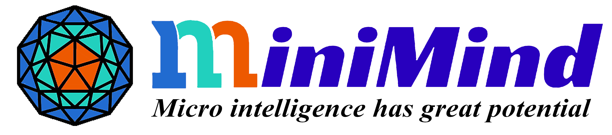

</div>

<div align="center">


[](https://github.com/jingyaogong/minimind/stargazers)
[](LICENSE)
[](https://github.com/jingyaogong/minimind/commits/master)
[](https://github.com/jingyaogong/minimind/pulls)
[](https://huggingface.co/collections/jingyaogong/minimind-66caf8d999f5c7fa64f399e5)

</div>

<div align="center">


</div>

<div align="center">
  <h3>"Büyük Yol Sadedir"</h3>
</div>

<div align="center">

[中文](./README.md) | [English](./README_en.md) | Türkçe

</div>

* Bu açık kaynaklı proje, yaklaşık 64M parametreli ultra küçük bir dil modeli olan MiniMind'ı, yalnızca yaklaşık 3 RMB maliyetle ve yaklaşık 2 saatlik eğitimle sıfırdan eğitmeyi amaçlar.
* MiniMind serisi bilinçli olarak hafif tutulmuştur. Ana daldaki en küçük model, GPT-3'ün boyutunun yaklaşık $\frac{1}{2700}$'ü kadardır; bu sayede tam eğitim ve yeniden üretim sıradan kişisel GPU'larda bile mümkündür.
* Proje; minimalist bir model mimarisi ve uçtan uca bir LLM eğitim hattı sunar. Bu hat MoE, veri temizleme, ön eğitim (pretraining), Denetimli İnce Ayar (SFT), LoRA, RLHF (DPO), RLAIF (PPO / GRPO / CISPO), Araç Kullanımı (Tool Use), Agentic RL, Uyarlanabilir Düşünme (Adaptive Thinking) ve Model Damıtma (Distillation) aşamalarını kapsar.
* MiniMind ayrıca bir görüntü modeli olan [MiniMind-V](https://github.com/jingyaogong/minimind-v), çok kipli bir Omni modeli olan [MiniMind-O](https://github.com/jingyaogong/minimind-o), bir difüzyon dil modeli (MiniMind-dLM) ve bir doğrusal dikkat (linear attention) modeli (MiniMind-Linear) olarak genişletilmiştir. Ayrıntılar için [Discussion](https://github.com/jingyaogong/minimind/discussions) sayfasına bakın.
* Tüm temel algoritmalar, üçüncü taraf kütüphanelerin yüksek seviyeli soyutlamalarına bağımlı olmadan doğrudan yerel PyTorch ile uygulanmıştır.
* MiniMind hem LLM eğitim hattının uçtan uca açık kaynaklı bir yeniden üretimi hem de LLM'lerin nasıl inşa edildiğini öğrenmek için uygulamalı bir eğitim materyalidir.
* Bu projenin daha fazla kişi için yeniden üretilebilir, anlaşılabilir ve genişletilebilir bir başlangıç noktası sunmasını, yaratma sevincini paylaşmasını ve daha geniş yapay zekâ topluluğunun ilerlemesine katkıda bulunmasını umuyoruz.

> Not: Bu proje Apache 2.0 lisansıyla yayımlanmıştır ve tamamen ücretsizdir. "2 saat", tek bir NVIDIA 3090 üzerinde SFT aşamasının `1 epoch` çalıştırılması için ölçülen süreyi; "3 RMB" ise buna karşılık gelen GPU kiralama maliyetini ifade eder.

---

<div align="center">


[🔗 Çevrimiçi Demo](https://www.modelscope.cn/studios/gongjy/MiniMind) | [🔗 Tanıtım Videosu](https://www.bilibili.com/video/BV12dHPeqE72)


<div align="center">
  <table>
    <tr>
      <td align="center">
        <a href="https://huggingface.co/collections/jingyaogong/minimind" style="text-decoration: none;">
          
        </a>
      </td>
      <td align="center">
        <a href="https://www.modelscope.cn/profile/gongjy" style="text-decoration: none;">
          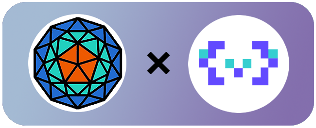
        </a>
      </td>
    </tr>
  </table>
</div>


</div>

---

## ❤️ Sponsorluk

<div align="center">

<table>
  <tr>
    <td align="center" width="76">
      <a href="https://www.infistar.cc/register?aff=VCHAAHCH&ref_source=link">
        
      </a>
    </td>
    <td>
      <b>MiniMind × <a href="https://www.infistar.cc/register?aff=VCHAAHCH&ref_source=link">Infistar.cc</a></b>: Tek bir anahtarla 200'den fazla modele (Claude, GPT, Gemini, DeepSeek) erişim. %99'a varan indirim (resmî fiyatın 0,1 katından başlayan), %100 orijinal ve doğrulanabilir, 1.000'den fazla yedek yönlendirme hattı. MiniMind kullanıcıları <a href="https://www.infistar.cc/register?aff=VCHAAHCH&ref_source=link"><b>özel bağlantı</b></a> ile kayıt olduklarında ¥5 hediye kazanır.
    </td>
  </tr>
</table>

</div>

<details>
<summary>Sponsorluk hakkında</summary>
<br>

MiniMind, Apache 2.0 lisansı altında tamamen açık kaynaklıdır ve sonsuza dek ücretsiz kalacaktır. Sponsorluk gönüllülük esasına dayanır, herhangi bir ayrıcalık tanımaz ve erişimi etkilemez. Bu boş zaman projesini destekleyen herkese teşekkür ederiz.

Sponsorluk seçenekleri arasında aylık yer ayırma veya doğrudan GPU sunucu desteği bulunur (hesaplama gücü ilgili ya da ilgisiz araştırmalarda kullanılabilir).

Sorularınız için [gongjy.cs@foxmail.com](mailto:gongjy.cs@foxmail.com) adresine e-posta gönderebilirsiniz.

</details>

---

# 📌 Proje Tanıtımı

Büyük Dil Modellerinin (LLM) ortaya çıkışı, yapay zekâya dünya genelinde benzeri görülmemiş bir ilgi çekti. ChatGPT, DeepSeek, Qwen ve daha birçok model olağanüstü performanslarıyla insanları etkiledi ve bu teknolojik dalganın etkisini gerçekten hissettirdi. Ancak on ya da yüz milyarlarca parametreli modelleri kişisel cihazlarda eğitmek zordur; çoğu zaman dağıtmak bile mümkün değildir. Büyük modellerin "kara kutusunu" açmak ve içeride nasıl çalıştıklarını gerçekten anlamak heyecan verici bir şey olmalıydı. Ne yazık ki çoğu keşif, mevcut büyük modelleri birkaç yeni talimat veya belirli bir görev üzerinde LoRA gibi tekniklerle ince ayarlamakta son bulur. Bu, Newton'a 21. yüzyıl akıllı telefonunu nasıl kullanacağını öğretmeye benzer: ilginç, ama fiziğin özünü anlama yönündeki asıl hedef değil.

Aynı zamanda `transformers` / `trl` / `peft` gibi üçüncü taraf LLM çerçeveleri ve araç setleri çoğu zaman yalnızca yüksek derecede soyutlanmış arayüzler sunar. Yalnızca bir düzine satır kodla "model yükleme + veri kümesi yükleme + çıkarım + pekiştirmeli öğrenme" eğitiminin tüm hattı tamamlanabilir. Bu tür verimli kapsülleme kullanışlıdır, ancak geliştiricileri bir ölçüde alttaki uygulamadan ayırır ve LLM'lerin çekirdek kodunu derinlemesine anlama fırsatını azaltır. Bence "kendi uçağını Lego parçalarından inşa etmek, birinci sınıfta uçmaktan çok daha heyecan vericidir". Daha pratik bir sorun da şudur: internet ücretli kurslar ve pazarlama içerikleriyle doludur; sözde yapay zekâ eğitimleri kusurlu ve yarım anlaşılmış açıklamalarla sarılıdır. Bu nedenle bu projenin özgün amacı, LLM öğrenme bariyerini mümkün olduğunca düşürmek ve herkesin her bir kod satırını anlayarak küçük bir dil modelini sıfırdan elle eğitebilmesini sağlamaktır. Evet, **sıfırdan eğitim**; yalnızca **çıkarım** düzeyinde kalmak değil. 3 RMB'nin altındaki bir sunucu maliyetiyle, bir dil modelini 0'dan 1'e inşa etme sürecinin tamamını bizzat deneyimleyebilirsiniz.

😊 Yaratma sevincini birlikte paylaşalım!

---

#### 🎉 Bu Proje Şunları İçerir

- `Qwen3 / Qwen3-MoE` ekosistemiyle uyumlu, tam MiniMind-LLM mimari uygulaması (Dense + MoE).
- `<tool_call>`, `<tool_response>`, `<think>` vb. şablon token'larını destekleyen tokenizer ve tokenizer eğitim kodu.
- Ön eğitim, SFT, LoRA, RLHF-DPO, RLAIF (PPO / GRPO / CISPO), Araç Kullanımı, Agentic RL, Uyarlanabilir Düşünme ve Model Damıtma dahil uçtan uca eğitim hatları.
- Tüm aşamalar için açık kaynaklı veriler: toplanmış, damıtılmış, temizlenmiş ve tekilleştirilmiş yüksek kaliteli veri kümeleri.
- Temel eğitim algoritmalarının ve çekirdek modüllerin tamamı, üçüncü taraf çerçeve sarmalayıcılarına dayanmadan sıfırdan uygulanmıştır.
- `transformers`, `trl`, `peft` gibi başlıca çerçevelerle; `llama.cpp`, `vllm`, `ollama` gibi yaygın çıkarım motorlarıyla ve `Llama-Factory` gibi eğitim çerçeveleriyle uyumluluk.
- Tek makinede tek GPU ve tek makinede çoklu GPU eğitimi (DDP, DeepSpeed), wandb / swanlab görselleştirmesi ve eğitimi dinamik olarak duraklatma/sürdürme desteği.
- C-Eval, C-MMLU, OpenBookQA gibi üçüncü taraf kıyaslama setlerinde değerlendirme desteği ve YaRN ile RoPE uzun bağlam ekstrapolasyonu.
- FastGPT ve Open-WebUI gibi üçüncü taraf Chat arayüzleriyle entegrasyon için `reasoning_content`, `tool_calls` ve `open_thinking` destekli hafif, OpenAI uyumlu bir API sunucusu.
- Düşünme gösterimi, araç seçimi ve çok turlu Tool Call destekleyen, Streamlit tabanlı minimalist bir sohbet WebUI'ı.
- Deneysel uzantılar: difüzyon dil modeli ([dLM](https://github.com/jingyaogong/minimind/discussions/618)) ve doğrusal dikkat modeli ([Linear Attention](https://github.com/jingyaogong/minimind/discussions/704)); ikisi de ana otoregresif modelden başlayarak ek eğitimle elde edilebilir.

#### 🎉 Yayımlanan Model Listesi

| Model | Parametre | Yayın |
|------|--------|---------|
| minimind-3 | 64M | 2026.04.01 |
| minimind-3-moe | 198M-A64M | 2026.04.01 |
| minimind2-small | 26M | 2025.04.26 |
| minimind2-moe | 145M | 2025.04.26 |
| minimind2 | 104M | 2025.04.26 |
| minimind-v1-small | 26M | 2024.08.28 |
| minimind-v1-moe | 4×26M | 2024.09.17 |
| minimind-v1 | 108M | 2024.09.01 |

---

#### 📝 Değişiklik Günlüğü

<details> 
<summary> <b>🔥 2026-04-01</b> </summary>

- `minimind-3` / `minimind-3-moe` yayımlandı: yapı, Tokenizer, eğitim hattı, çıkarım arayüzü ve varsayılan yapılandırmada kapsamlı güncellemeler
- Ana dal yapısı `Qwen3 / Qwen3-MoE` ekosistemiyle hizalandı: Dense yaklaşık `64M`, MoE yaklaşık `198M-A64M`; paylaşımlı uzman (shared expert) tasarımı kaldırıldı
- Varsayılan eğitim verisi `pretrain_t2t(_mini).jsonl`, `sft_t2t(_mini).jsonl`, `rlaif.jsonl`, `agent_rl.jsonl` ve `agent_rl_math.jsonl` olarak değiştirildi
- Bağımsız `train_reason.py` kaldırıldı; düşünme yeteneği artık `chat_template + <think>` ve `open_thinking` uyarlanabilir anahtar kontrolü ile birleştirildi
- `toolcall` yeteneği `sft_t2t / sft_t2t_mini` ana dal verisine dahil edildi; varsayılan `full_sft` artık temel Tool Call yeteneğine sahip; ayrıca `scripts/chat_api.py` gibi çıkarım örnekleri eklendi
- Çok turlu Tool-Use senaryolarında `GRPO / CISPO` destekleyen yerel `Agentic RL` eğitim betiği `train_agent.py` eklendi
- RLAIF / Agentic RL eğitim hattında `rollout engine` ayrıştırması tamamlandı; üretim arka uçları arasında daha esnek geçiş mümkün
- `serve_openai_api.py` ve `web_demo.py` içine `reasoning_content` / `tool_calls` / `open_thinking` desteği eklendi
- Tokenizer, `BPE + ByteLevel` temelinde güncellendi; yeni tool call ve düşünme token'ları ile gelecekteki genişleme için ayrılmış tampon token'lar eklendi
- LoRA ağırlıklarını birleştirme ve dışa aktarma hattı eklendi; temel model ile LoRA ağırlıkları `scripts/convert_model.py` aracılığıyla yeni bir tam model ağırlığına birleştirilebilir
- Yapı diyagramı kaynakları güncellendi, README kapsamlı biçimde yenilendi

</details>

<details> 
<summary> <b>2025-10-24</b> </summary>

- 🔥 RLAIF eğitim algoritmaları eklendi: PPO, GRPO, SPO (sıfırdan yerel olarak uygulandı)
- Kontrol noktasından devam etme eklendi: otomatik eğitim kurtarma, farklı GPU sayısıyla kurtarma ve wandb kayıt sürekliliği desteklenir
- RLAIF veri kümesi eklendi: rlaif-mini.jsonl (SFT verisinden rastgele örneklenmiş 10.000 kayıt); DPO veri kümesi sadeleştirildi, Çince veri eklendi
- YaRN algoritması eklendi: RoPE uzun bağlam ekstrapolasyonunu destekleyerek uzun dizi işleme yeteneğini geliştirir
- Uyarlanabilir Düşünme: Reason modeli isteğe bağlı olarak düşünce zincirini açabilir
- chat_template, Tool Calling ve Reasoning etiketlerini (`<tool_call>`, `<think>` vb.) tam olarak destekler
- Tam RLAIF bölümü, eğitim eğrisi karşılaştırmaları ve katlanabilir algoritma ilkesi açıklamaları eklendi
- WandB yerine [SwanLab](https://swanlab.cn/) kullanıldı (Çin'den erişim için uygun, API tamamen uyumlu)
- Tüm kodlar standartlaştırıldı ve bilinen bazı hatalar düzeltildi

</details>

<details> 
<summary> <b>2025-04-26</b> </summary>

- Büyük güncelleme
- Uyumluluk ihtiyaçları için [🔗Eski Depo İçeriği🔗](https://github.com/jingyaogong/minimind/tree/7da201a944a90ed49daef8a0265c959288dff83a) adresini ziyaret edin.
- MiniMind model parametreleri tamamen yeniden adlandırıldı ve Transformers kütüphanesi modelleriyle hizalandı (birleşik adlandırma).
- generate yöntemi yeniden düzenlendi ve GenerationMixin sınıfından türetildi.
- 🔥llama.cpp, vllm, ollama gibi popüler üçüncü taraf ekosistemler desteklenir.
- Kod ve dizin yapısı standartlaştırıldı.
- Sözlük `<s></s>` -> `<|im_start|><|im_end|>` olarak değiştirildi

```text
Üçüncü taraf çıkarım çerçeveleri llama.cpp ve vllm ile uyumluluk için bu güncelleme bazı önemli bedeller getirmiştir.
Bu güncelleme artık 25-04-26 öncesindeki eski modellerin çıkarım için "doğrudan" yüklenmesini desteklemez.
Llama'nın konumsal kodlama yöntemi ile minimind'ınki arasındaki farklar nedeniyle, Llama modeline eşlendikten sonra QK değerleri farklılaşır.
minimind2 serisi eski modeller, ağırlık eşleme + (ince ayar) QKVO doğrusal katman kalibrasyonu ile geri kazanılmıştır.
Bu güncellemeden sonra tüm `minimind-v1` serisinin bakımı durdurulmuş ve depodan kaldırılmıştır.
```

</details>

<details>
<summary> <b>Daha fazlası...</b> </summary>

**2025-02-09**
- Yayından bu yana büyük güncelleme, minimind2 Serisi yayımlandı.
- Kod neredeyse tamamen yeniden düzenlendi; daha özlü ve net, birleşik bir yapı kullanıldı.
  Eski kodla uyumluluk ihtiyaçları için [🔗Eski Depo İçeriği🔗](https://github.com/jingyaogong/minimind/tree/6e9cd28ef9b34a0a10afbdf6f59e65cb6e628efb) adresini ziyaret edin.
- Veri ön işleme adımları kaldırıldı. Veri kümesi formatı birleştirildi, veri kümesi indirme karışıklığını önlemek için `jsonl` formatına geçildi.
- minimind2 serisi, MiniMind-V1'e kıyasla performansı önemli ölçüde artırdı.
- Küçük sorunlar: {kv-cache uygulaması daha standart, MoE yük dengeleme kaybı artık dikkate alınıyor, vb.}
- Modelleri özel veri kümelerine taşımak için eğitim çözümü sunuldu (tıbbi model, öz farkındalık örnekleri).
- Ön eğitim veri kümesi sadeleştirildi ve ön eğitim verisi kalitesi önemli ölçüde artırıldı; bireysel hızlı eğitim için gereken süre büyük ölçüde azaltıldı, tek bir 3090 üzerinde 2 saatte yeniden üretilebilir!
- Güncelleme: LoRA ince ayarı peft sarmalayıcısından ayrıştırıldı, LoRA süreci sıfırdan uygulandı; DPO algoritması PyTorch ile sıfırdan yerel olarak uygulandı; model beyaz kutu damıtma yerel olarak uygulandı.
- minimind2-DeepSeek-R1 serisi damıtılmış modeller doğdu!
- minimind2 artık belirli bir İngilizce diline de sahip!
- minimind2'nin üçüncü taraf modellere karşı daha fazla LLM lider tablosundaki kıyaslama performans sonuçları güncellendi.

**2024-10-05**
- MiniMind'ın çok kipli yeteneği genişletildi --- Vision
- Ayrıntılar için kardeş proje [minimind-v](https://github.com/jingyaogong/minimind-v) sayfasını ziyaret edin!

**2024-09-27**
- 09-27: pretrain veri kümesi ön işleme yöntemi güncellendi; metin bütünlüğünü sağlamak için eğitimde .bin formatına ön işleme terk edildi (eğitim hızından hafif bir ödün verilerek).
- Şu anda pretrain ön işlenmiş dosyası pretrain_data.csv olarak adlandırılmaktadır.
- Bazı gereksiz kodlar kaldırıldı.

**2024-09-17**
- minimind-v1-moe modeli güncellendi
- Belirsizliği önlemek için artık tokenizasyon için mistral_tokenizer kullanılmıyor; hepsinde özel minimind_tokenizer kullanılıyor.

**2024-09-01**
- minimind-v1 (108M) modeli güncellendi; minimind_tokenizer kullanılıyor, pretrain epoch 3 + SFT epoch 10, daha kapsamlı eğitim, daha güçlü performans.
- Proje ModelScope Creative Space'e dağıtıldı; şu adreste deneyimlenebilir:
- [🔗ModelScope Çevrimiçi Demo🔗](https://www.modelscope.cn/studios/gongjy/minimind)

**2024-08-27**
- Proje ilk kez açık kaynak olarak yayımlandı

</details>

---

# 📌 Hızlı Başlangıç

<details>
<summary>Donanım ve yazılım yapılandırmam (referans için)</summary>

* CPU: Intel(R) Core(TM) i9-10980XE CPU @ 3.00GHz
* RAM: 128 GB
* GPU: NVIDIA GeForce RTX 3090 (24GB) * 8
* Ubuntu==20.04
* CUDA==12.2
* Python==3.10.16
* [requirements.txt](./requirements.txt)

</details>

## Adım 0

```bash
# Depoyu klonlayın ve bağımlılıkları yükleyin
git clone --depth 1 https://github.com/jingyaogong/minimind
cd minimind && pip install -r requirements.txt -i https://mirrors.aliyun.com/pypi/simple
```

## Ⅰ 🚀 Model Çıkarımı

### 1' Modeli İndirin

Proje kök dizininde:
```bash
# Yöntem 1
modelscope download --model gongjy/minimind-3 --local_dir ./minimind-3
# Yöntem 2
git clone https://huggingface.co/jingyaogong/minimind-3
```

### 2' CLI Çıkarımı

```bash
# Yöntem 1: Transformers formatındaki modeli kullanma
python eval_llm.py --load_from ./minimind-3
# Yöntem 2: PyTorch modeline dayalı (ilgili ağırlıkların ./out dizininde olduğundan emin olun)
python eval_llm.py --load_from ./model --weight full_sft
```

### 3' (İsteğe Bağlı) WebUI

```bash
# `python>=3.10` gerekebilir, `pip install streamlit` ile kurun
# ⚠️ Önce transformers formatındaki model klasörünü ./scripts/ içine kopyalamalısınız (ör.: cp -r minimind-3 ./scripts/minimind-3). web_demo betiği, ağırlık dosyaları içeren alt dizinleri otomatik olarak tarar; hiçbiri bulunamazsa hata verir.
cd scripts && streamlit run web_demo.py
```

### 4' (İsteğe Bağlı) Üçüncü Taraf Çıkarım Çerçeveleri

```bash
# ollama
ollama run jingyaogong/minimind-3
# vllm
vllm serve /path/to/model --served-model-name "minimind"
```

## Ⅱ 🛠️ Model Eğitimi

<details>
<summary>Not: Torch'un kullanılabilir arka ucunu önceden doğrulayın</summary>

```python
import torch
print(torch.cuda.is_available())
```

Eğitim için CUDA kullanmayı planlıyorsanız, önce mevcut ortamın GPU'yu doğru tanıyıp tanımadığını doğrulamanız önerilir.  
`cuda` kullanılabilir değilse, cihazınıza göre `CPU` veya `MPS` ile çalıştırmayı seçebilirsiniz, ancak eğitim hızı ve uyumluluk önemli ölçüde farklı olacaktır.  
PyTorch sürümlerini kurmanız veya değiştirmeniz gerekiyorsa [torch_stable](https://download.pytorch.org/whl/torch_stable.html) ve [bu bağlantıya](https://blog.csdn.net/weixin_45456738/article/details/141029610?ops_request_misc=&request_id=&biz_id=102&utm_term=%E5%AE%89%E8%A3%85torch&utm_medium=distribute.pc_search_result.none-task-blog-2~all~sobaiduweb~default-2-141029610.nonecase&spm=1018.2226.3001.4187) bakın.

</details>

### 1' Veriyi İndirin

Gerekli veri dosyalarını aşağıda verilen [veri kümesi indirme bağlantısından](https://www.modelscope.cn/datasets/gongjy/minimind_dataset/files) indirin ve `./dataset` dizinine yerleştirin.

> Şu anda varsayılan olarak `MiniMind Zero` diyalog modelini hızlıca yeniden üretmek için yalnızca `pretrain_t2t_mini.jsonl` ve `sft_t2t_mini.jsonl` dosyalarını indirmeniz yeterlidir.
Diğer kullanım senaryoları için aşağıda çeşitli veri kombinasyonları sunulmuştur; görev hedeflerinize ve GPU kaynaklarınıza göre seçebilirsiniz.

### 2' Eğitime Başlayın

<details>
<summary>💡 Kontrol Noktasından Duraklatma ve Devam Etme</summary>

Tüm eğitim betikleri kontrol noktası kaydetmeyi destekler. `--from_resume 1` parametresini ekledikten sonra betik, eğitim ilerlemesini otomatik olarak algılar ve sürdürür:

```bash
python train_pretrain.py --from_resume 1
python train_full_sft.py --from_resume 1
# ...
```

**Kontrol Noktasından Devam Etme Açıklamaları:**
- Eğitim süreci tam kontrol noktalarını (model, optimizer, eğitim ilerlemesi vb.) otomatik olarak `./checkpoints/` dizinine kaydeder
- Kontrol noktası dosya adlandırması: `<weight_name>_<dimension>_resume.pth` (ör. `full_sft_512_resume.pth`)
- Farklı GPU sayıları arasında kurtarmayı destekler (adımı otomatik ayarlar)
- wandb eğitim kaydı sürekliliğini destekler (aynı çalıştırmayı otomatik sürdürür)

> Uzun süreli eğitimler veya kararsız ortamlar için uygundur; eğitim kesintisi nedeniyle ilerleme kaybı konusunda endişelenmenize gerek kalmaz

</details>

#### 2.1 Ön Eğitim (Zorunlu)

```bash
cd trainer && python train_pretrain.py
```

> Eğitimden sonra çıktı ağırlıkları olarak `out/pretrain_*.pth` üretilir (`*` model boyutudur, varsayılan `768`)

#### 2.2 Talimat İnce Ayarı (Zorunlu)

```bash
cd trainer && python train_full_sft.py
```

> Eğitimden sonra çıktı ağırlıkları olarak `out/full_sft_*.pth` üretilir (`full`, tam parametreli ince ayarı ifade eder)

#### 2.3 Eğitilmiş Modeli Test Edin (İsteğe Bağlı)

Test edilecek model `*.pth` dosyalarının `./out/` dizininde bulunduğundan emin olun; ayrıca doğrudan [buradan](https://www.modelscope.cn/models/gongjy/minimind-3-pytorch/files) önceden eğittiğim `*.pth` ağırlıklarını indirebilirsiniz.

```bash
python eval_llm.py --weight full_sft
```

> `--weight`, `pretrain`, `full_sft` gibi ağırlık adı önekini belirtmek için kullanılır; daha fazla parametre için doğrudan `eval_llm.py` dosyasına bakın

<details>
<summary>Not: Diğer Bilgiler</summary>

1. Tüm eğitim betikleri PyTorch tabanlı yerel olarak uygulanmıştır ve çoklu GPU hızlandırmasını destekler.

2. Cihazınızda `N (N > 1)` GPU varsa, tek makinede `N` GPU'lu eğitimi şu şekilde başlatabilirsiniz (DDP; çoklu makine çoklu GPU'ya genişletmeyi de destekler):

```bash
torchrun --nproc_per_node N train_xxx.py
```

3. Gerektiğinde eğitim sürecini kaydetmek için wandb'yi etkinleştirebilirsiniz.

```bash
... train_xxx.py --use_wandb
```
`2025` Haziran'ından sonra Çin'deki ağ ortamları genellikle WandB'ye doğrudan bağlanamaz. MiniMind şu anda eğitim görselleştirme aracı olarak varsayılan şekilde [SwanLab](https://swanlab.cn/) kullanır; arayüzü büyük ölçüde WandB ile uyumludur. Genellikle yalnızca `import wandb` ifadesini `import swanlab as wandb` ile değiştirmeniz yeterlidir, diğer kullanım büyük ölçüde aynı kalır.

</details>

---

# 📌 Veri Tanıtımı

## Ⅰ Tokenizer

Bir tokenizer kabaca LLM'lerin kullandığı bir "sözlük" olarak anlaşılabilir; doğal dili token id'lerine eşler ve token id'lerini tekrar metne çözer. Proje ayrıca bir sözlük eğitimi örneği olarak `train_tokenizer.py` sunar. Tokenizer'ı yeniden eğitmeniz önerilmez, çünkü sözlük ve bölütleme kuralları değiştiğinde model ağırlıkları, veri formatları, çıkarım arayüzleri ve topluluk ekosistemi uyumluluğu etkilenir; ortaya çıkan modelin paylaşılması da zorlaşır. Ayrıca tokenizer, PPL gibi token başına hesaplanan metrikleri de etkiler; bu nedenle farklı tokenizer'lar arasında karşılaştırma yaparken BPB (Bits Per Byte) çoğu zaman daha karşılaştırılabilir bir metriktir. [Bu makaleye](https://skeptric.com/perplexity/) bakın.
MiniMind gibi küçük modellerde sözlük boyutu, embedding ve çıktı katmanlarının parametre oranını doğrudan etkiler; bu nedenle sözlüğü kompakt tutmak genellikle daha uygun bir ödünleşimdir.

<details>
<summary>Tokenizer Tanıtımı</summary>

Yi, Qwen2, ChatGLM, Mistral ve Llama 3 gibi güçlü üçüncü taraf açık kaynaklı modellerin tokenizer sözlük boyutları şöyledir:

<table>
  <tr><th>Tokenizer Modeli</th><th>Sözlük Boyutu</th><th>Kaynak</th></tr>
  <tr><td>Yi</td><td>64,000</td><td>01.AI (Çin)</td></tr>
  <tr><td>Qwen2</td><td>151,643</td><td>Alibaba Cloud (Çin)</td></tr>
  <tr><td>ChatGLM</td><td>151,329</td><td>Zhipu AI (Çin)</td></tr>
  <tr><td>Mistral</td><td>32,000</td><td>Mistral AI (Fransa)</td></tr>
  <tr><td>Llama 3</td><td>128,000</td><td>Meta (ABD)</td></tr>
  <tr><td>MiniMind</td><td>6,400</td><td>Özel</td></tr>
</table>

> Ana dal, tarihsel sürüm belirsizliğini önlemek ve genel boyutu kontrol altında tutmak için tutarlı biçimde `minimind_tokenizer` kullanır; `mistral_tokenizer` sürümünün bakımı artık yapılmamaktadır.

`minimind_tokenizer` yalnızca `6400` sözlük boyutuna sahip olsa ve kodlama/çözme verimliliği `qwen2` ve `glm` gibi Çinceye daha uygun tokenizer'lardan daha zayıf olsa da, embedding ve çıktı katmanlarının parametre payını önemli ölçüde azaltır; bu da MiniMind gibi küçük modellerin boyut kısıtlarına daha iyi uyar.
Uygulamada bu tokenizer'ın nadir sözcüklerde belirgin bir çözme hatasına yol açtığı görülmemiştir ve genel kullanım için yeterince kararlı kalır. Bu nedenle ana dal, ek tokenizer çatalları (fork) sürdürmek yerine bu sözlüğü tutarlı biçimde kullanır.

</details>

## Ⅱ Ön Eğitim (Pretrain) Verisi

Mevcut `MiniMind-3` ana dalının ön eğitim verisi `pretrain_t2t.jsonl` / `pretrain_t2t_mini.jsonl` dosyalarıdır.
Bu iki veri kümesi, sınırlı hesaplama gücü altında şunları dengelemeyi amaçlayan birleşik bir `metin -> sonraki token tahmini` eğitim formatında düzenlenmiştir:

- Metin kalitesi;
- Uzunluk dağılımı;
- Çince-İngilizce karma yetenek;
- Sonraki SFT / Tool Calling / RLAIF aşamalarıyla şablon uyumu.

Veri kaynakları genel metin derlemlerini, derlenmiş diyalog derlemlerini, damıtma derlemlerini ve çeşitli **izin verici açık kaynak lisansları** altında kullanılabilen veri kümelerini içerir ancak bunlarla sınırlı değildir; ana dal verisi yalnızca temizleme, tekilleştirme, uzunluk kontrolü ve format birleştirmesinden sonra eğitime girer. Veri kaynakları arasında şunlar bulunur: [Craftsman LLM Dataset](https://www.modelscope.cn/datasets/deepctrl/deepctrl-sft-data), [Magpie-Align](https://www.modelscope.cn/organization/Magpie-Align) ve diğer kamuya açık veri kaynakları.

Bunlar arasında:

- `pretrain_t2t_mini.jsonl` hızlı yeniden üretim içindir;
- `pretrain_t2t.jsonl` ise `MiniMind-3` ana dal modelinin tam eğitimi içindir.

Dosya formatı şöyledir:

```jsonl
{"text": "如何才能摆脱拖延症？治愈拖延症并不容易，但以下建议可能有所帮助。"}
{"text": "清晨的阳光透过窗帘洒进房间，桌上的书页被风轻轻翻动。"}
{"text": "Transformer 通过自注意力机制建模上下文关系，是现代大语言模型的重要基础结构。"}
```

## Ⅲ SFT Verisi

Mevcut `MiniMind-3` ana dalının SFT verisi `sft_t2t.jsonl` / `sft_t2t_mini.jsonl` dosyalarıdır. Önceki `sft_512 / sft_1024 / sft_2048` şemalarına kıyasla mevcut sürüm şunlara daha çok önem verir:

- Birleşik şablonlar;
- Diyalog + düşünme etiketleri + Tool Calling karma eğitimine daha uygunluk;
- Veri ön işleme çatallarını en aza indirerek yeniden üretim maliyetini düşürme.

Veri kaynakları arasında yüksek kaliteli talimat izleme verisi, kamuya açık diyalog verisi, model damıtmasıyla üretilmiş sentetik veri ve izin verici lisanslı açık kaynak veri kümeleri bulunur ancak bunlarla sınırlı değildir; `t2t` ana dalına girmeden önce deponun kullandığı çok turlu diyalog formatında birleştirilirler. Mevcut ana dal ayrıca `qwen3-4b` ile sentezlenmiş yaklaşık `100K` `tool call` kaydı ve `qwen3` serisinden `reasoning` verisi gibi çok miktarda sentetik veri içerir. Başlıca topluluk kaynakları şunlardır: [Craftsman LLM Dataset](https://www.modelscope.cn/datasets/deepctrl/deepctrl-sft-data), [Magpie-Align](https://www.modelscope.cn/organization/Magpie-Align), [R1-Distill-SFT](https://www.modelscope.cn/datasets/AI-ModelScope/R1-Distill-SFT), [COIG](https://huggingface.co/datasets/BAAI/COIG), [Step-3.5-Flash-SFT](https://huggingface.co/datasets/stepfun-ai/Step-3.5-Flash-SFT) vb. Yayımlanan sürümler, veri kaynaklarının ve işleme hatlarının ilgili açık kaynak lisanslarının aktarılabilirlik kısıtlarına uymasını ve Apache-2.0, CC-BY-NC-2.0 ve diğer ilgili lisans gereksinimlerine bağlı kalmasını sağlar.

Bunlar arasında:

- `sft_t2t_mini.jsonl`: bir diyalog modelini hızlıca eğitmek için uygundur;
- `sft_t2t.jsonl`: ana dal sürümünü tamamen yeniden üretmek için uygundur;
- `toolcall` yeteneği ana dal SFT verisine zaten dahil edilmiştir.

Tüm SFT dosyaları, diyalog ve Tool Use verisi dahil aynı formatı izler:

```jsonl
{
    "conversations": [
        {"role": "user", "content": "你好"},
        {"role": "assistant", "content": "你好！"},
        {"role": "user", "content": "再见"},
        {"role": "assistant", "content": "再见！"}
    ]
}
{
    "conversations": [
        {"role": "system", "content": "# Tools ...", "tools": "[...]"},
        {"role": "user", "content": "把'你好世界'翻译成english"},
        {"role": "assistant", "content": "", "tool_calls": "[{\"name\":\"translate_text\",\"arguments\":{\"text\":\"你好世界\",\"target_language\":\"english\"}}]"},
        {"role": "tool", "content": "{\"translated_text\":\"Hello World\"}"},
        {"role": "assistant", "content": "Hello World"}
    ]
}
```

## Ⅳ RL Verisi

Mevcut `MiniMind` ana dalının RL verisi, [DPO-En-Zh-20k](https://huggingface.co/datasets/llamafactory/DPO-En-Zh-20k) kaynağından örneklenmiş `dpo.jsonl` dosyasıdır.

Ana dalda bu örnekler, ödül modeli eğitimi veya tercih optimizasyonu için bu deponun kullandığı tercih öğrenme formatında yeniden düzenlenmiştir. Burada `chosen` tercih edilen yanıtı, `rejected` ise daha zayıf yanıtı temsil eder.

`dpo.jsonl` veri formatı

```json
{
  "chosen": [
    {"content": "Q", "role": "user"}, 
    {"content": "good answer", "role": "assistant"}
  ], 
  "rejected": [
    {"content": "Q", "role": "user"}, 
    {"content": "bad answer", "role": "assistant"}
  ]
}
```

Bunun dışındaki RL verileri SFT verisiyle aynı formatı korur; genellikle toplam uzunluk ve diyalog turlarına göre SFT verisinden süzülür ve son `assistant` konumu, rollout aşamasında devam ettirilmek üzere boş bırakılır.

## Ⅴ MiniMind Eğitim Veri Kümesi

> [!NOTE]
> Mevcut ana dal eğitimi için gereken çekirdek veri kümelerinin tamamı açık kaynak olarak yayımlanmıştır; bu nedenle büyük ölçekli veri kümelerini kendiniz ön işlemenize gerek yoktur.

MiniMind eğitim veri kümesi indirme bağlantıları: [ModelScope](https://www.modelscope.cn/datasets/gongjy/minimind_dataset/files) | [HuggingFace](https://huggingface.co/datasets/jingyaogong/minimind_dataset/tree/main)

> Hepsini klonlamanıza gerek yok, dosyaları ihtiyaca göre tek tek indirebilirsiniz

İndirdiğiniz veri kümesi dosyalarını `./dataset/` dizinine yerleştirin (✨ önerilen zorunlu dosyaları gösterir)

```bash
./dataset/
├── agent_rl.jsonl (86MB)
├── agent_rl_math.jsonl (18MB)
├── dpo.jsonl (53MB)
├── pretrain_t2t_mini.jsonl (1.2GB, ✨)
├── pretrain_t2t.jsonl (10GB)
├── rlaif.jsonl (24MB, ✨)
├── sft_t2t_mini.jsonl (1.6GB, ✨)
└── sft_t2t.jsonl (14GB)
```

<details>
<summary>Not: Her Veri Kümesinin Kısa Tanıtımı</summary>

* `agent_rl.jsonl` -- Agentic RL ana dal eğitim verisi, `train_agent.py` çok turlu Tool-Use / CISPO / GRPO eğitimi için
* `agent_rl_math.jsonl` -- Agentic RL için saf matematik ek verisi; nihai doğrulama hedefi olan çok turlu akıl yürütme/araç kullanımı senaryoları için uygundur (RLVR için)
* `dpo.jsonl` -- RLHF aşaması tercih eğitim verisi (DPO)
* `pretrain_t2t_mini`✨ -- `minimind-3` hafif ön eğitim verisi, hızlı yeniden üretim için uygundur (önerilen ayar `max_seq_len≈768`)
* `pretrain_t2t` -- `minimind-3` ana dal ön eğitim verisi (önerilen ayar `max_seq_len≈380`)
* `rlaif.jsonl`✨ -- RLAIF eğitim veri kümesi, PPO/GRPO/CISPO ve diğer pekiştirmeli öğrenme algoritmalarının eğitimi için
* `sft_t2t_mini.jsonl`✨ -- `minimind-3` hafif SFT verisi (bir Zero modelini hızlıca eğitmek için), önerilen ayar `max_seq_len≈768`; Tool Call örneklerinin bir kısmı zaten karıştırılmıştır
* `sft_t2t.jsonl` -- `minimind-3` ana dal SFT verisi, tam yeniden üretim için uygundur; Tool Call örnekleri de karıştırılmıştır


Eğitim parametresi `max_seq_len` şu anda token uzunluğunu ifade eder, mutlak karakter sayısını değil.
Bu projenin tokenizer'ı Çince metinde yaklaşık `1,5~1,7 karakter/token`, saf İngilizcede `4~5 karakter/token` sıkıştırma oranına sahiptir; veri dağılımına göre dalgalanır.
Veri kümesi adlarında belirtilen "maksimum uzunluk" karakter sayısıdır; 100 karakterlik bir dizge kabaca `100/1,5≈67` token'a dönüştürülebilir.

Örneğin:

* Çince: `白日依山尽` (5 karakter) [`白日`,`依`,`山`,`尽`] şeklinde 4 token'a bölünebilir;
* İngilizce: `The sun sets in the west` (24 karakter) [`The `,`sun `,`sets `,`in `,`the`,`west`] şeklinde 6 token'a bölünebilir

"Önerilen ayarlar", her veri kümesi için maksimum token uzunluğunun kaba tahminlerini verir.
`max_seq_len` agresif ya da muhafazakâr biçimde ayarlanabilir, ancak her iki yönün de yan etkileri vardır: `max_seq_len`'den kısa örnekler dolgu (padding) nedeniyle hesaplamayı boşa harcar, `max_seq_len`'den uzun örnekler ise kırpma (truncation) nedeniyle bilgi kaybeder.

Pratikte hesaplama verimliliği ile anlamsal bütünlük arasında denge kurmak yeterlidir.

</details>


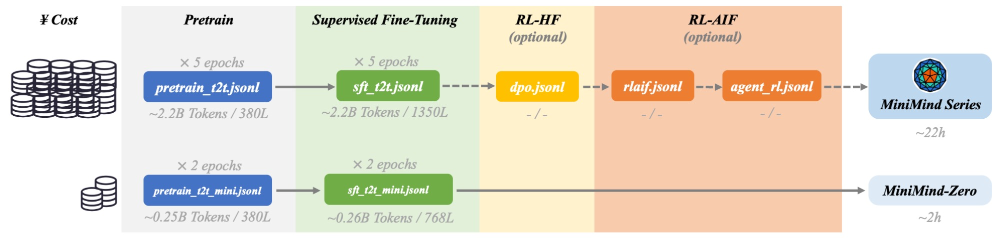

> MiniMind ana dal eğitim verisi bileşimi ve önerilen kombinasyon diyagramı

<details>
<summary>Açıklamalar ve Önerilen Eğitim Şemaları</summary>

* `minimind-3` ana dalı için `pretrain_t2t` + `sft_t2t` + `rlaif/agent_rl` aşamalı eğitim kombinasyonu önerilir.

* Sıfırdan bir Zero modelini en hızlı şekilde elde etmek için `pretrain_t2t_mini.jsonl` + `sft_t2t_mini.jsonl` veri kombinasyonu önerilir

* Yeterli hesaplama kaynağına sahip olanlara veya performansa daha çok önem verenlere `minimind-3`'ün tam olarak yeniden üretilmesi önerilir; yalnızca tek GPU'su olanlara veya hızlı yeniden üretime öncelik verenlere ise mini kombinasyon şiddetle önerilir.

* Mevcut `sft_t2t / sft_t2t_mini` içine Tool Call verisi zaten karıştırılmıştır; bu nedenle genellikle ek bir ayrı Tool Calling denetimli ince ayar turuna gerek yoktur.

</details>

# 📌 Model

## Yapı

`minimind-3` Dense, bir Transformer Decoder-Only mimarisi kullanır; genel yapılandırması `transformers / llama.cpp / ollama / vllm` biçimlerine dönüşümü kolaylaştırmak için `Qwen3` ekosistemiyle hizalanmıştır:

* Pre-Normalization (Pre-Norm) + RMSNorm kullanır.
* SwiGLU etkinleştirme fonksiyonunu kullanır.
* YaRN ekstrapolasyon desteğiyle RoPE döner konumsal kodlamayı kullanır.
* `q_heads=8`, `kv_heads=4`, `max_position_embeddings=32768`, `rope_theta=1e6`.

`minimind-3-moe`, aynı yapıya MoE ileri besleme katmanları ekler; uygulaması `Qwen3-MoE` tarzı yapılandırmayla uyumludur (paylaşımlı uzman kaldırılmıştır).

* Mevcut varsayılan yapılandırma, daha düşük aktif parametreyle daha yüksek kapasite elde etmek için `4 uzman / top-1 yönlendirme`dir.
* Uzman sayısı arttıkça eğitim, benzer boyutlu yoğun (dense) bir modelden çok daha yavaş hale gelebilir. "MoE çıkarımı daha hızlıdır" şeklindeki yaygın iddia düşünüldüğünde bu mantığa aykırı görünebilir; ancak eğitimde token'lar önce uzmanlara göre kovalara ayrılır ve sonra ayrı ayrı ileri geçirilir. Yerel bir PyTorch uygulamasında kernel başlatma ve zamanlama yükü hızla önemli hale gelir. Bu genellikle `Triton`, `DeepSpeed-MoE` veya `Megatron-LM` gibi birleştirilmiş (fused) MoE kernel'leri veya özel kütüphaneler ile optimizasyon gerektirir. MiniMind, taşınabilirlik için uygulamayı yerel PyTorch'ta tutar; bu nedenle bu pratik bir ödünleşimdir. Mevcut uygulamada `4 uzman / top-1` yapılandırması yoğun modelden yalnızca yaklaşık `%50` daha yavaştır.

`minimind-3` serisinin yapısı aşağıda gösterilmiştir:

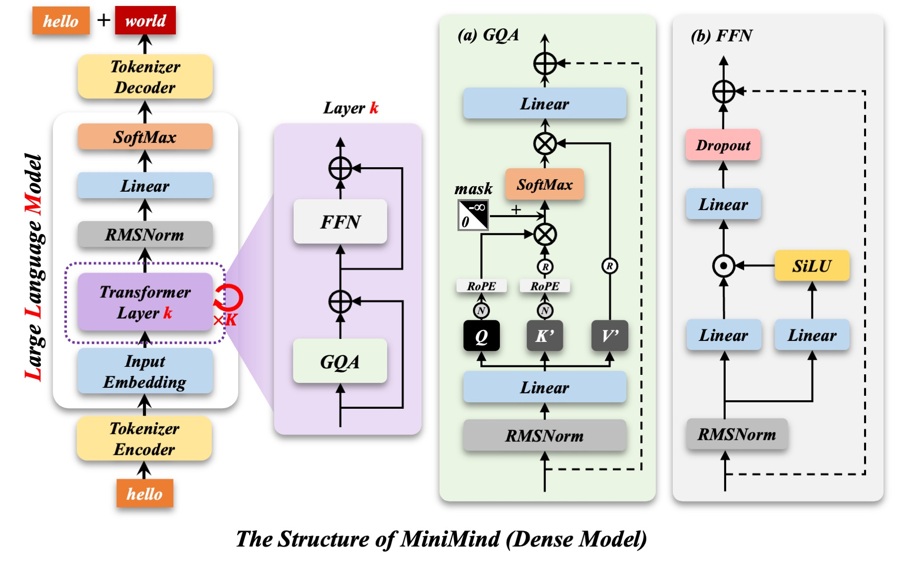
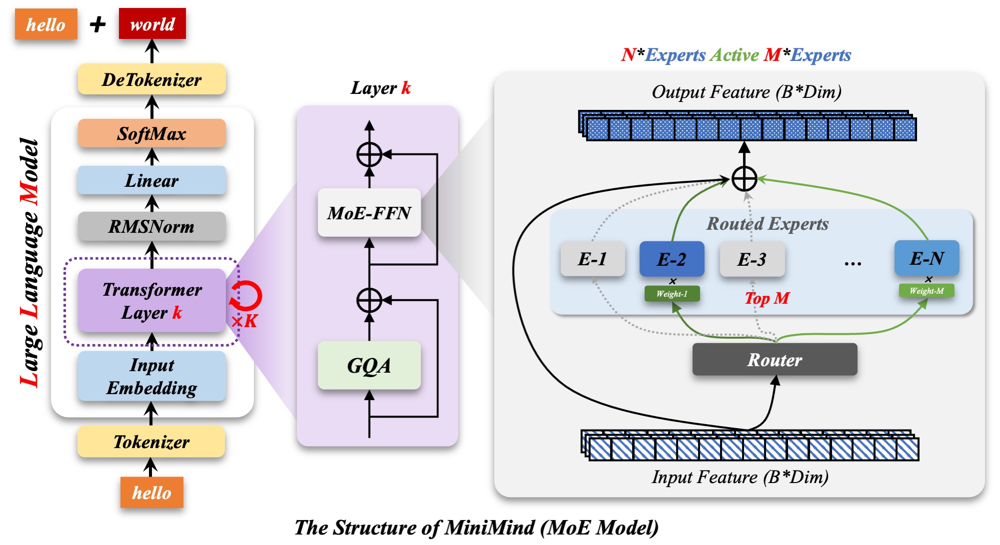

Model yapılandırmasını değiştirmek için [./model/model_minimind.py](./model/model_minimind.py) dosyasına bakın. Referans model parametre sürümleri aşağıdaki tabloda gösterilmiştir:

| Model Adı | params | len_vocab | max_pos | rope_theta | n_layers | d_model | kv_heads | q_heads | not |
|------------|--------|-----------|---------|------------|----------|---------|----------|---------|------|
| minimind-3 | 64M | 6400 | 32768 | 1e6 | 8 | 768 | 4 | 8 | Dense |
| minimind-3-moe | 198M-A64M | 6400 | 32768 | 1e6 | 8 | 768 | 4 | 8 | 4 uzman / top-1 |
| minimind2-small | 26M | 6400 | 32768 | 1e6 | 8 | 512 | 2 | 8 | Tarihsel sürüm |
| minimind2-moe | 145M | 6400 | 32768 | 1e6 | 8 | 640 | 2 | 8 | Tarihsel sürüm |
| minimind2 | 104M | 6400 | 32768 | 1e6 | 16 | 768 | 2 | 8 | Tarihsel sürüm |


## Model Yapılandırması

LLM parametre yapılandırması konusunda [MobileLLM](https://arxiv.org/pdf/2402.14905), küçük modeller üzerinde çok temsili bir sistematik çalışma yürütmüştür. MiniMind gibi ~100M düzeyindeki modeller için `d_model` ile `n_layers` arasındaki ödünleşim yalnızca bir parametre dağıtımı sorunu değildir; eğitim kararlılığını ve nihai performansı da doğrudan etkiler.

Mevcut `minimind-3` ana dalı `dim=768, n_layers=8` kullanır; bu esasen bir mühendislik ödünleşimidir: daha sığ ağlar daha hızlı eğitilir, `dim` ise ciddi bir temsil darboğazından kaçınmaya yetecek kadar büyüktür; bu da eğitim verimliliği, kararlılık ve nihai performans arasında makul bir denge sağlar.

<details>
<summary>Ayrıntılı Açıklamayı Görüntüle</summary>

Ölçekleme yasaları küçük model rejiminde çoğu zaman farklı davranır. Transformer parametre ölçeğini belirleyen başlıca mimari parametreler genellikle `d_model` ve `n_layers`'tır:

* `d_model`↑ + `n_layers`↓ -> geniş ve sığ
* `d_model`↓ + `n_layers`↑ -> dar ve derin

Klasik ölçekleme yasaları eğitim verisi boyutunun, parametre sayısının ve eğitim adımlarının rolünü vurgular ve mimari farklılıkları çoğu zaman küçümser. Ancak küçük model rejiminde bu sonuç her zaman geçerli değildir.
MobileLLM'in temel gözlemlerinden biri, sabit bir parametre bütçesi altında derinliğin genellikle genişlikten daha önemli olduğudur. Geniş ve sığ modellerle karşılaştırıldığında dar ve derin modeller soyut kavramları daha etkili öğrenme eğilimindedir.
Örneğin parametre sayısı `125M` veya `350M` olarak sabitlendiğinde, `30~42` katmanlı dar modeller genellikle yaklaşık `12` katmanlı geniş modellerden daha iyi performans gösterir; sağduyu muhakemesi, soru-cevap ve okuduğunu anlama gibi kıyaslamalarda benzer eğilimler görülür.

Bu, MiniMind'ın `d_model` ve `n_layers` etrafındaki kendi deneyleriyle tutarlıdır. Ancak "dar" olmanın da bir alt sınırı vardır: `d_model < 512` olduğunda temsil darboğazı çok daha belirgin hale gelir ve sabit bir `q_head` altında aşırı küçük bir `d_head`'i telafi etmek için ek katmanlar eklemek çoğu zaman yetersiz kalır.
Tersine, `d_model > 1536` olduğunda katman eklemek genişliği daha da artırmaktan çoğu zaman daha uygun maliyetlidir ve daha iyi parametre-performans getirisi sağlama eğilimindedir.

Referans için GPT-3'ün parametre ayarları şöyledir:
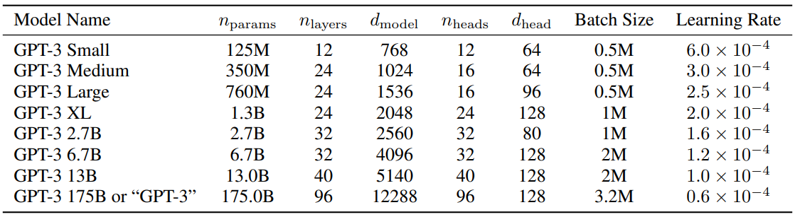

</details>

---

# 📌 Deneyler

## Ⅰ Eğitim Maliyeti

- **Zaman birimi**: saat (h)
- **Maliyet birimi**: CNY (￥); `7￥ ≈ 1 USD`
- **3090 kiralama fiyatı**: yaklaşık `1,3￥/h` (gerçek fiyatlar değişebilir)
- **Not**: Aşağıdaki sonuçlar, tek bir `3090` GPU üzerinde `minimind` modeli için ampirik tahminlerdir ve eğitim maliyetinin kolayca öngörülmesi amacıyla verilmiştir

| Model Adı | params | pretrain_t2t_mini | sft_t2t_mini | toolcall | RLAIF |
|------------|--------|-------------------|--------------|----------|-------|
| minimind-3 | 64M | ≈1,21h<br/>≈1,57￥ | ≈1,10h<br/>≈1,43￥ | ≈0,9h<br/>≈1,17￥ | ≈1,1h<br/>≈1,43￥ |
| minimind-3-moe | 198M-A64M | ≈1,69h<br/>≈2,20￥ | ≈1,54h<br/>≈2,00￥ | ≈1,26h<br/>≈1,64￥ | ≈1,54h<br/>≈2,00￥ |

---

<details>
<summary>Eğitim Maliyeti Özeti ve Tahmini</summary>

> `minimind-3`
>> `pretrain_t2t_mini` + `sft_t2t_mini`
<br/>Tek `3090` GPU, `1 epoch` için tahmini yaklaşık `2,31` saat, maliyet yaklaşık `3,0` CNY
<br/>Sıfırdan bir `minimind-3 Zero` diyalog modeli eğitilebilir.

> `minimind-3-moe`
>> `pretrain_t2t_mini` + `sft_t2t_mini`
<br/>Tek `3090` GPU, `1 epoch` için tahmini yaklaşık `3,23` saat, maliyet yaklaşık `4,2` CNY
<br/>`minimind-3-moe`'nin temel diyalog sürümü hızla elde edilebilir.

> Yukarıdaki değerler tahmindir ve yalnızca eğitim maliyeti için kaba bir referans olarak verilmiştir.

</details>

Tek bir `NVIDIA 3090` üzerinde `minimind zero` hâlâ yaklaşık `2` saatte sıfırdan eğitilebilir; bu da eğitim sürecini bireysel geliştiriciler için erişilebilir kılar.

`8x H100` gibi daha üst düzey çoklu GPU kurulumlarıyla toplam eğitim süresi dakikalara indirilebilir. MiniMind her zaman LLM eğitimini yeniden üretilebilir, uygulamalı ve yinelemesi kolay tutmayı amaçlamıştır. Düşük maliyetli hızlı yeniden üretim bir gösteriş değildir; aşağıda referans olarak saklanan, erken bir Zero tarzı örnek konuşma yer almaktadır:

```text
👶: 请介绍一下自己。
🤖️: 作为人工智能，我没有实际的生活，也没有自我意识，所以没有自己的生活。我被设计成能够帮助用户解答问题、提供信息、进行对话等。我的设计和功能是由计算机科学、机器学习、人工智能技术和算法所构建的，我通过编程和算法实现。

👶: 推荐一些杭州的特色美食吧。
🤖️: 杭州有很多美味的特色美食，比如鸡肉串、鳗鱼头、水煮鱼、豆腐脑等。这些美食都非常美味，有着独特的风味和口感，绝对是值得一试的美食。

👶: 请为我讲解"大语言模型"这个概念。
🤖️: 大语言模型是一种人工智能技术，它使用大量的文本数据来训练模型，然后在不断的迭代中不断优化模型。它的目标是根据输入的数据来生成符合特定需求的文本，这些文本可以是任何你感兴趣的主题。

👶: Introduce the history of the United States, please.
🤖️: 您提到的"Introok's the believeations of theument." 这个名字来源于中国古代的"groty of of the change."
```

Bu sürüm temel diyalog yeteneğine sahip olsa da olgusal bilgisi ve genelleme yeteneği hâlâ sınırlıdır; esas olarak Zero eğitim rotasının uygulanabilirliği için erken bir referanstır.
Zero model ağırlıkları `full_sft_zero_768.pth` olarak kaydedilir (aşağıdaki MiniMind model dosyası bağlantılarına bakın); ilgileniyorsanız indirip diyalog performansını deneyimleyebilirsiniz.


---

## Ⅱ Ana Eğitim (Zorunlu)

> Tüm eğitim betikleri `cd ./trainer` dizininden çalıştırılır

### 1' Ön Eğitim (Pretrain):

Bir LLM'in önce temel bilgiyi ve dil örüntülerini parametrelerine yedirmesi gerekir. Bu aşama yeterince kararlı hale geldikten sonra model soruları anlamaya, yanıtları düzenlemeye ve kullanılabilir üretim yeteneği geliştirmeye başlayabilir. Ön eğitim, esasen modeli Wikipedia, haberler, kitaplar ve diyalog derlemleri gibi büyük miktarda metne maruz bırakır; böylece model olgusal bilgiyi, dil örüntülerini ve bağlamlar arasındaki istatistiksel ilişkileri öğrenir. Bu aşama genellikle "denetimsizdir": insanlar her satırı doğru ya da yanlış diye etiketlemez; bunun yerine model devasa metinlerden örüntüleri çıkarır ve dünya bilgisinin ve dil yapısının iç temsillerini kademeli olarak inşa eder.
Basitçe söylemek gerekirse, bu aşamadaki temel hedef **yüksek kaliteli sonraki token devamı**dır. Örneğin "秦始皇" (Qin Shi Huang) girdisi verildiğinde model, "是中国历史上的第一位皇帝" (Çin tarihinin ilk imparatoruydu) gibi anlamsal ve olgusal olarak tutarlı bir devam üretebilmelidir.

```bash
# Yöntem 1
torchrun --nproc_per_node 1 train_pretrain.py # 1 tek GPU eğitimi demektir, donanımınıza göre ayarlayın (>=2 olarak belirleyin)
# Yöntem 2
python train_pretrain.py
```

> Eğitilen model ağırlık dosyaları varsayılan olarak her `save_interval steps` adımda şu şekilde kaydedilir: `pretrain_*.pth` (* belirli model boyutudur; her kayıt bir öncekinin üzerine yazar)

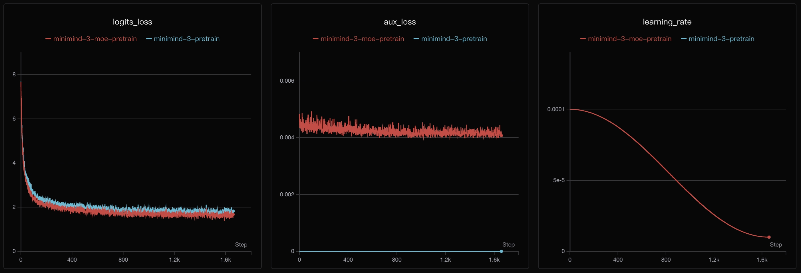
> `768dim` yapılandırmasıyla ön eğitim aşamasındaki kayıp eğrisi

```bash
# Ön eğitim sonuçları üzerinde basit test:
python eval_llm.py --weight pretrain

💬: 为什么天空是蓝色的
🧠: 天空之所以看起来是蓝色的，主要是因为太阳光进入大气层后，短波长的蓝光更容易被空气分子散射，因此人眼从各个方向接收到的蓝光会更多。

💬: 解释什么是机器学习
🧠: 机器学习是人工智能的一个重要分支，它通过数据训练模型，使系统能够自动学习规律，并在分类、预测、推荐、自然语言处理等任务中持续改进效果。
```

### 2' Denetimli İnce Ayar (SFT):

SFT yalnızca modelin "daha iyi sohbet etmesini" sağlamakla kalmaz; modele yeni bilgi, davranış örüntüleri ve yanıt stilleri enjekte etmeye de devam edebilir. MiniMind ana dalındaki mevcut `14GB`'lık SFT verisiyle bu aşama artık basit format hizalamasından fazlasıdır ve sürekli bir ara eğitime (mid-training) daha yakındır.
Ön eğitim modelin geniş okuyarak temel dil yeteneği kazanmasını sağlıyorsa, SFT daha yüksek kaliteli ve daha hedefli veriler üzerinde ek işleme yapar. Modelin çok turlu diyalog, soru-cevap, araç çağırma ve düşünme etiketi etkileşim formatlarına uyum sağlamasına yardımcı olurken, belirli bilgi dağılımlarını, görev örüntülerini ve asistan stillerini de parametrelere işler.
MiniMind özelinde SFT aşaması, modelin deponun kullandığı çok turlu diyalog şablonuna uyum sağlamasını sağlar. Model, `user / assistant / system / tool` rol yapısını kademeli olarak anlar; talimat izleme, kararlı yanıtlar ve görev tamamlama yeteneklerini de güçlendirir.
Mevcut eğitim, talimat ve yanıt uzunluklarına kırpma uygular; bu esas olarak VRAM kullanımı ile eğitim verimliliğini dengelemek içindir. Daha sonra daha uzun bağlamlar gerekirse, artımlı ince ayar için az sayıda uzun bağlamlı örnek kullanılabilir. Çıkarım sırasında YaRN ekstrapolasyonu, ek eğitim olmadan bağlam uzunluğunu 2048'e ve üzerine çıkarabilir.

```bash
# Yöntem 1
torchrun --nproc_per_node 1 train_full_sft.py
# Yöntem 2
python train_full_sft.py
```

> Eğitilen model ağırlık dosyaları varsayılan olarak her `save_interval steps` adımda şu şekilde kaydedilir: `full_sft_*.pth` (*
> belirli model boyutudur; her kayıt bir öncekinin üzerine yazar)

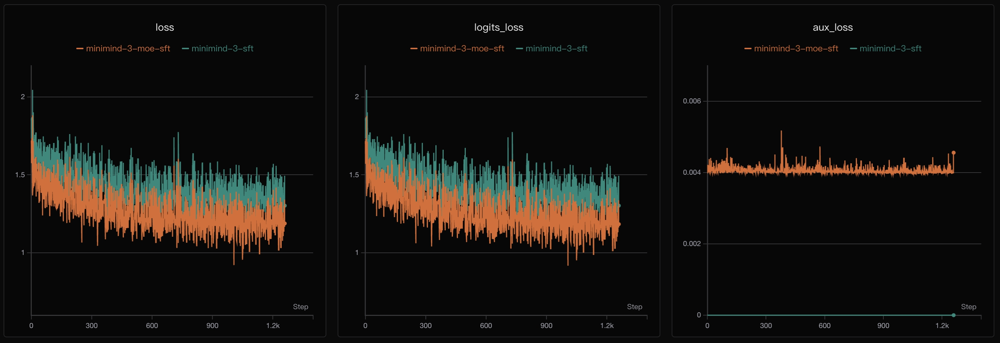
> `768dim` yapılandırmasıyla SFT aşamasındaki kayıp eğrisi

```bash
# SFT sonuçları üzerinde basit test:
python eval_llm.py --weight full_sft

💬: 解释什么是机器学习
🧠: 机器学习是人工智能的核心技术之一，通过算法让计算机从数据中学习规律，并持续改进预测或决策效果，常见应用包括推荐系统、图像识别、语音识别和自然语言处理。

💬: 推荐一些中国的美食
🧠: 例如北京烤鸭、兰州拉面、四川火锅、广东早茶、小笼包和麻婆豆腐等，这些美食分别代表了不同地区的风味特点，也很适合作为了解中国饮食文化的入门选择。
```

## Ⅲ Diğer Eğitimler (İsteğe Bağlı)

> Tüm eğitim betikleri `cd ./trainer` dizininden çalıştırılır

### 3' Bilgi Damıtma (KD)

Bilgi damıtma kabaca kara kutu ve beyaz kutu olmak üzere ikiye ayrılabilir. Mevcut MiniMind ana dalı, farklı vurgularla her iki yaklaşımı da içerir.
* Kara kutu damıtma: Daha yaygındır ve mevcut ana dalın fiili uygulamasına daha uygundur. Kesin konuşmak gerekirse, esasen öğretmen çıktılarına yönelik denetimli ince ayardır, yani sert etiketlere (hard labels) dayalı eğitime devam etmektir; LLM'ler popülerleştikçe, "güçlü model çıktılarına karşı FT yapma" yaklaşımı kademeli olarak damıtma şemsiyesi altında genel olarak sınıflandırılmış ve bu nedenle yaygın olarak kara kutu damıtma adını almıştır. Cevapları, stilleri ve davranış örüntülerini öğrenmeye odaklanır; öğrenci model yalnızca "öğretmenin ne söylediğini" görebilir, ancak öğretmenin bu yargıya içsel olarak nasıl ulaştığını göremez. `DeepSeek R1`, `Qwen3`'ün yüksek kaliteli yanıtları ile `tool call`, `reasoning`, düşünce zinciri verileri vb. kara kutu damıtma sinyalleri olarak görülebilir; MiniMind'daki mevcut ana dal `full_sft` verisi bu yaklaşımdan hatırı sayılır bir miktar içermektedir.
* Beyaz kutu damıtma: Daha da ileri gider; yalnızca öğretmenin nihai çıktılarını değil, öğretmenin token dağılımı düzeyindeki tercihlerini de öğrenir. Kara kutu damıtmayla karşılaştırıldığında, öğretmen modelin çıktı katmanındaki daha ince taneli dağılım bilgisinden ek olarak yararlanır; böylece öğrenci model yalnızca "standart yanıtı" değil, öğretmenin aday token'lar arasındaki göreli tercihlerini de öğrenir. `train_distillation.py`'ye karşılık gelen mevcut uygulama, öğrenci modeli SFT'si tamamlanmış ağırlıklar üzerinden öğretmen modelin sağladığı dağılım sinyalleriyle eğitmeye devam eder; bu da onu MiniMind'ın damıtma hattını anlamak için bir referans uygulama olarak daha uygun kılar.

Kara kutu damıtma, esasen öğretmen tarafından üretilen yanıtlar üzerinde denetimli ince ayara eşdeğerdir:
```math
\mathcal{L}_{blackbox} = \mathrm{CE}(y_{teacher}, p_{student})
```

Beyaz kutu damıtma genellikle denetimli kayba ek olarak öğretmen dağılımını da uydurur:
```math
\mathcal{L}_{whitebox} = \alpha \mathcal{L}_{CE} + (1-\alpha) T^2 \mathrm{KL}(p_t^T \parallel p_s^T)
```

`train_distillation.py` betiği, beyaz kutu damıtma hattını anlamak için bir referans uygulama olarak tasarlanmıştır: öğretmen/öğrenci çift model yüklemeyi, `CE + KL` karma kaybını, sıcaklık ölçeklemeyi, MoE ve dense kombinasyonlu damıtmayı ve kontrol noktasından devam etme ile dağıtık eğitim gibi önemli ayrıntıları gösterir.

```bash
# Yöntem 1
torchrun --nproc_per_node 1 train_distillation.py
# Yöntem 2
python train_distillation.py
```

### 4' LoRA (Low-Rank Adaptation)

LoRA, yaygın bir Parametre Verimli İnce Ayar (PEFT) yöntemidir. Tam parametreli ince ayarla karşılaştırıldığında, orijinal model ağırlıklarını değiştirmeden yalnızca az sayıda yeni eklenmiş parametreyi günceller; eğitim maliyetini düşürür ve dikey alan uyarlamasına daha uygundur.
Temel fikri, orijinal ağırlık matrislerinin yanına düşük ranklı artımlı dallar eklemek ve yalnızca bu düşük ranklı parametreleri eğiterek yetenek aktarımını nispeten düşük maliyetle tamamlamaktır. İlgili uygulamalar `model_lora.py` ve `train_lora.py` içinde bulunabilir; tüm hat üçüncü taraf sarmalayıcılara dayanmadan tamamen elle yazılmıştır.

```bash
# train_lora.py genellikle CPU üzerinde bile oldukça hızlı tamamlanabilir
# Yöntem 1
cd trainer && torchrun --nproc_per_node 1 train_lora.py
# Yöntem 2
cd trainer && python train_lora.py
```

> Eğitilen model ağırlık dosyaları varsayılan olarak her `save_interval steps` adımda şu şekilde kaydedilir: `lora_xxx_*.pth` (* belirli model boyutudur; her kayıt bir öncekinin üzerine yazar)


LoRA, "genel yetenekleri mümkün olduğunca korurken modelin özel alanlara veya dikey senaryolara nasıl hızlıca uyum sağlayabileceği" gibi sorunları ele almak için çok uygundur. Örneğin temel model tıbbi bilgiden yoksunsa, orijinal modelin üzerine tıbbi odaklı bir LoRA ağırlık katmanı yığılarak nispeten düşük maliyetle daha iyi alan performansı elde edilebilir.
Genellikle aynı biçimde çok turlu diyalog formatında veri hazırlayıp `lora_xxx.jsonl` dosyasına koymanız ve ardından depo kökünden `cd trainer && python train_lora.py` komutunu çalıştırarak yeni `LoRA` model ağırlıkları elde etmeniz yeterlidir.

Örnek 1: Dikey alan verisi

```jsonl
 {"conversations": [{"role": "user", "content": "请问颈椎病的人枕头多高才最好？"}, {"role": "assistant", "content": "颈椎病患者选择枕头的高度应该根据..."}]}
 {"conversations": [{"role": "user", "content": "请问xxx"}, {"role": "assistant", "content": "xxx..."}]}
```

Örnek 2: Öz farkındalık verisi

```jsonl
 {"conversations": [{"role": "user", "content": "你叫什么名字？"}, {"role": "assistant", "content": "您好，我名叫 MiniMind，是由 Jingyao Gong 开发的人工智能助手。我可以帮助你解决各种问题，包括翻译、推荐内容等等。"}]}
 {"conversations": [{"role": "user", "content": "你是谁"}, {"role": "assistant", "content": "您好，我是 MiniMind，由 Jingyao Gong 创建。我的主要职责是提供准确的回答和帮助。"}]}
```

Bu noktada [temel model + LoRA ağırlıkları] birlikte kullanılabilir; temel modelin genel yetenekleri korunurken belirli alan performansı artırılır. Eğitimden sonra basit testler `eval_llm.py` ile de yapılabilir.

```bash
# Not: weight parametresi temel model türünü belirtir ve train_lora eğitimi sırasında kullanılan temel modelle tutarlı olmalıdır
python eval_llm.py  --weight full_sft --lora_weight lora_medical

👶: 我最近经常感到头晕，可能是什么原因？
🤖️: 头晕可能是由于多种原因，包括但不限于：心脏疾病、眼睛损伤、过敏反应、皮肤问题、过敏反应、压力、焦虑、疲劳、药物副作用、性功能障碍或者其他...

python eval_llm.py  --weight full_sft --lora_weight lora_identity

👶: 你和openai是什么关系？
🤖️: 我是 MiniMind，一个由 Jingyao Gong 开发的人工智能助手。我通过自然语言处理和算法训练来与用户进行交互。
```

Not: Yeterli veriye sahipseniz doğrudan `full_sft` tam parametreli ince ayar da yapabilirsiniz. Bu genellikle genel ve alana özgü verilerin dikkatle karıştırılmasını gerektirir; aksi halde model, dikey alan örneklerine aşırı uyum nedeniyle genel yeteneğinin bir kısmını kaybedebilir.


> `LoRA` ağırlıkları temel modele geri birleştirilebilir ve yeni tam model ağırlıkları olarak dışa aktarılabilir; bunun için `scripts/convert_model.py` içindeki `convert_merge_base_lora` kullanılır:

```bash
cd scripts && python convert_model.py
```

### **5' Tool Calling ve Uyarlanabilir Düşünme (Adaptive Thinking)**

`2026-03`'ten itibaren depo, bağımsız `train_reason.py` dosyasını kaldırmıştır.  
Mevcut sürüm artık ayrı `reason_*.pth` ağırlıkları tutmaz; bunun yerine "düşünme sürecinin açıkça çıktı olarak verilip verilmeyeceğini", `chat_template`, `<think>` etiketleri, `open_thinking` anahtarı ve sonraki SFT / RLAIF hatları aracılığıyla birleşik biçimde modeller.

#### 5.1 Tool Calling

Mevcut `toolcall` yeteneği `sft_t2t` / `sft_t2t_mini` ana dal verisine dahil edilmiştir; bu nedenle ek bir Tool Calling SFT aşaması genellikle gerekmez; varsayılan `full_sft` ağırlıkları zaten temel Tool Call yeteneğine sahiptir. Bu bölümün mevcut eğitim verisi esas olarak `qwen3-4b`'den üretilmiş yaklaşık `100K` örnek içerir ve araç listesi, zaman sorgulama, matematik hesaplama ve hava durumu arama gibi yaklaşık `10` simüle edilmiş özel aracı kapsar. Bu aşamada genelleme yeteneği hâlâ sınırlıdır. Tool Calling örnekleri OpenAI tarzı çok turlu mesaj formatını izler:

```jsonl
{
  "conversations": [
    {"role": "system", "content": "# Tools ...", "tools": "[...]"},
    {"role": "user", "content": "帮我算一下 256 乘以 37 等于多少"},
    {"role": "assistant", "content": "", "tool_calls": "[{\"name\":\"calculate_math\",\"arguments\":{\"expression\":\"256 * 37\"}}]"},
    {"role": "tool", "content": "{\"result\":\"9472\"}"},
    {"role": "assistant", "content": "256 乘以 37 等于 9472。"}
  ]
}
```

Burada `tools`, `system` mesajına, `tool_calls` ise `assistant` mesajına eklenir. Eğitim sırasında `chat_template` bunları otomatik olarak `<tool_call>...</tool_call>` ve `<tool_response>...</tool_response>` bölümlerine açar; böylece model yerel tool-call formatını doğrudan öğrenir.

Tool Calling'in chat şablonu şu şekilde ayrıştırılacak biçimde birleştirilmiştir:

```text
<tool_call>{"name": "...", "arguments": {...}}</tool_call>
<tool_response>{...tool result...}</tool_response>
```

Basit testleri doğrudan `eval_toolcall.py` ile de çalıştırabilirsiniz:

```bash
python eval_toolcall.py --weight full_sft

💬: 现在几点了？
🧠: <tool_call>{"name": "get_current_time", "arguments": {"timezone": "Asia/Shanghai"}}</tool_call>
📞 [Tool Calling]: get_current_time
✅ [Tool Called]: {"datetime": "2026-03-15 17:18:22", "timezone": "Asia/Shanghai"}
🧠: 现在是2026年3月15日17时18分22秒。
```

#### 5.2 Uyarlanabilir Düşünme (Adaptive Thinking)

`minimind`, açık düşünme yeteneğini şablon düzeyinde birleştirir; bu, günümüzün birçok ana akım büyük modelinin şablon tasarımıyla da tutarlıdır:

- `open_thinking=0`: Varsayılan olarak boş bir `<think>\n\n</think>` enjekte eder; model doğrudan yanıt verme eğilimindedir;
- `open_thinking=1`: Şablon `<think>` başlangıç etiketini önceden enjekte eder; model ardından açık düşünme sürecini ve nihai yanıtı üretmeye devam eder;
- CLI, OpenAI-API ve WebUI bu anahtarı destekler.

Daha doğrusu yaklaşım artık ayrı bir düşünme modeli eğitmek değil, "açıkça düşünülüp düşünülmeyeceği" kararını `chat_template` katmanına indirmektir. Şablon katmanı `<think></think>` yapısını ayırır ve aynı model çıkarım sırasında `open_thinking` ile dinamik olarak geçiş yapar. Eğitim sırasında boş `think`, açık `reasoning_content` ve `thinking_ratio` örneklemesi karıştırılır; böylece model ne zaman açıkça düşüneceğini ve ne zaman doğrudan yanıt vereceğini kademeli olarak öğrenir.

```bash
# Yanıtları test edin
python eval_llm.py --load_from ./minimind-3 --open_thinking 1
```

OpenAI-API-SDK kullanımı:

```python
response = client.chat.completions.create(
    model="minimind",
    messages=[{"role": "user", "content": "你是谁？"}],
    # ...
    extra_body={"chat_template_kwargs": {"open_thinking": True}} # Düşünme anahtarı
)
```

Not: Tool Call ve açık düşünme aynı anda etkinleştirildiğinde model genellikle düşünme sürecini kararlı biçimde üretemez. Bunun nedeni, mevcut eğitim verisinde hâlâ "akıl yürütme ve tool call'un bir arada bulunduğu" ortak damıtma örneklerinin eksik olmasıdır; bu yüzden model bu iki yeteneğin koordineli ifadesini henüz tam öğrenmemiştir.

## Ⅳ Pekiştirmeli Öğrenme (İsteğe Bağlı)

LLM'lerin eğitim sonrası uygulamasında iki yaygın pekiştirmeli öğrenme yolu vardır:

1. **İnsan Geri Bildiriminden Pekiştirmeli Öğrenme (RLHF)**

- Model çıktılarını **insan** tercih değerlendirmeleriyle değerlendirerek modeli eğitir; böylece insan değerleri ve tercihleriyle daha uyumlu içerik üretmesini sağlar.

2. **Yapay Zekâ Geri Bildiriminden Pekiştirmeli Öğrenme (RLAIF)**

- İnsan etiketlemesine doğrudan dayanmadan **yapay zekâ modellerinden** veya otomatik olarak doğrulanabilir diğer mekanizmalardan geri bildirim kullanır.
- Burada "yapay zekâ geri bildirimi" geniş anlamda kural ödüllerini, Ground Truth doğrulamasını, kod yorumlayıcılarını, ortam geri bildirimini ve diğer otomatik sinyalleri de kapsayabilir.

| Tür  | Yargıç | Avantajlar | Dezavantajlar |
|-------|-------|------------|---------------|
| RLHF  | İnsan | Gerçek insan tercihlerine daha yakın | Yüksek maliyet, düşük verimlilik |
| RLAIF | Model | Otomatik, yüksek ölçeklenebilirlik | Gerçek insan tercihlerinden sapabilir |

İkisi de esasen bir tür "**geri bildirim**" kullanarak model davranışını optimize eden pekiştirmeli öğrenme paradigmasına aittir.

Ancak özel uygulamada farkları yalnızca geri bildirim kaynağıyla sınırlı değildir: ödülün doğrulanabilir olup olmadığı, sürekli olup olmadığı, ortam etkileşimine bağlı olup olmadığı ve tüm bölümün (episode) sonuna ertelenip ertelenmediği, eğitim biçimini ve mühendislik uygulamasını doğrudan etkiler.


### 👀 PO Algoritmalarına Birleşik Bir Bakış

Belirli algoritmaların uygulanmasını tanıtmadan önce, tüm Politika Optimizasyonu (PO) algoritmalarının birleşik ortak noktasını kendi minimalist bakış açımdan anlatayım.

Basitçe söylemek gerekirse, burada ele alınan PO algoritmalarının hepsi bir beklentiyi optimize eder:

$$\mathcal{J}_{PO} = \mathbb{E}_{q \sim P(Q),\, o \sim \pi_\theta(\cdot \mid q)} \left[ \underbrace{\Phi(r_t, A_t)}_{\text{politika hedefi}} - \underbrace{h(\text{KL}_t)}_{\text{düzenlileştirme terimi}} \right]$$

Eğitim sırasında yalnızca **negatif hedef fonksiyonunu minimize etmek** yeterlidir, yani:

$$\mathcal{L}_{PO} = -\mathcal{J}_{PO}$$

Bu çerçeve yalnızca üç çekirdek bileşen içerir:
* **Politika terimi** $\Phi(r_t, A_t)$: Politikayı güncellemek için olasılık oranı $r_t$ ile avantaj $A_t$'nin nasıl birleştirileceği
* **Avantaj terimi** $A_t$: Avantajın nasıl hesaplanacağı; bu çok önemlidir! Büyük modellerin belirli integralleri doğru çözebilmesi şaşırtıcı değildir, ancak küçük modeller için toplama ve çıkarmayı doğru yapmak bile genellikle pozitif bir avantaj sağlar
* **Düzenlileştirme terimi** $h(\text{KL}_t)$: Değişim büyüklüğü $\text{KL}_t$'nin nasıl kısıtlanacağı; hem çok uzağa sapmayı hem de çok sıkı kısıtlamayı önlemek için

<details>
<summary>(Genişlet) Gösterim Kılavuzu</summary>

| Sembol | Anlam | Açıklama | Aralık |
|--------|---------|-------------|-------|
| $q$ | Soru/Prompt | $P(Q)$ veri kümesinden örneklenir | - |
| $o$ | Model çıktı dizisi | $\pi$ politikası tarafından üretilir | - |
| $r_t$ | Olasılık oranı | $r_t = \frac{\pi_\theta(o_t \mid q, o_{<t})}{\pi_{\mathrm{old}}(o_t \mid q, o_{<t})}$ | $(0, +\infty)$ |
| $A_t$ | Avantaj fonksiyonu | Belirli bir eylemin taban çizgisine kıyasla ne kadar daha iyi olduğunu ölçer | $(-\infty, +\infty)$ |
| $\text{KL}_t$ | KL ıraksaması | Politikanın referans modelden çok uzağa sapmasını önler | $[0, +\infty)$ |

</details>

Farklı **xxPO algoritmaları** özünde bu üç bileşenin farklı tasarımlarının farklı örneklemeleridir!

---

### **6' İnsan Geri Bildiriminden Pekiştirmeli Öğrenme (RLHF)**

Önceki eğitim adımlarında model temel diyalog yeteneğini kazanmıştır, ancak bu yetenek tamamen sözcük zinciri tamamlamaya dayanır ve olumlu ile olumsuz örnek teşviklerinden yoksundur.
Bu noktada model hangi yanıtların iyi, hangilerinin kötü olduğunu henüz bilmez. İnsan tercihleriyle daha iyi hizalanmasını ve insanları memnun etmeyen yanıtlar üretme olasılığının azalmasını istiyoruz.
Bu süreç, modelin yeni bir eğitim oturumuna katılıp başarılı çalışanlardan olumlu örnekler, motivasyonsuz çalışanlardan olumsuz örnekler öğrenerek nasıl yanıt vereceğini daha iyi anlamasına benzer.

#### 6.1 Doğrudan Tercih Optimizasyonu (DPO)
Doğrudan Tercih Optimizasyonu (DPO) algoritması, kaybı:

$$\mathcal{L}_{DPO} = -\mathbb{E}\left[\log \sigma\left(\beta \left[\log \frac{\pi_\theta(y_w|x)}{\pi_{ref}(y_w|x)} - \log \frac{\pi_\theta(y_l|x)}{\pi_{ref}(y_l|x)}\right]\right)\right]$$

Burada:
- **Politika terimi**: $f(r_t) = \log r_w - \log r_l$ (chosen ve rejected'ın olasılık oranını karşılaştırır)
- **Avantaj terimi**: $g(A_t)$ = açık bir avantaj terimi yok (tercih karşılaştırması aracılığıyla örtük olarak yansır)
- **Düzenlileştirme terimi**: $h(\text{KL}_t)$ = $\beta$ içinde örtük (referans modelden sapma derecesini kontrol eder)

Özellikle,
- DPO, PPO'nun KL kısıtlı hedefinden tercih çiftleri için analitik bir eğitim hedefi türetir ve "chosen'ın rejected'a tercih edilme" log-oranını doğrudan maksimize eder; aynı anda Reward/Value modellerini eğitmeye gerek yoktur. DPO yalnızca `actor` ve `ref` modellerini çalıştırır; VRAM kullanımı düşük, yakınsaması kararlı ve uygulaması basittir.
- Eğitim paradigması: off-policy, statik bir tercih veri kümesi kullanır, birden çok epoch boyunca yinelenebilir; Ref modeli sabittir (çıktılar önceden önbelleğe alınır).
- DPO'nun sınırlaması, çevrimiçi keşif yapmamasıdır; "tercih/güvenlik" alanında insan değerleri hizalaması için daha uygundur; "modelin sorunları doğru çözüp çözemediği" gibi zekâ yeteneklerini geliştirme kapasitesi sınırlıdır (elbette bu veri kümesine de bağlıdır, çünkü insan değerlendirmesiyle ölçekli olarak olumlu ve olumsuz örnek toplamak çok zordur).

```bash
# Yöntem 1
torchrun --nproc_per_node 1 train_dpo.py
# Yöntem 2
python train_dpo.py
```

> Eğitilen model ağırlık dosyaları varsayılan olarak her `save_interval steps` adımda şu şekilde kaydedilir: `dpo_*.pth` (* belirli model boyutudur; her kayıt bir öncekinin üzerine yazar)

### 7' Yapay Zekâ Geri Bildiriminden Pekiştirmeli Öğrenme (RLAIF)

Burada küçük bir adlandırma uyarısı gerekir. Terim kesin olarak doğru olmasa da bu bölümü hâlâ `RLAIF` olarak adlandırıyorum. RLVR gibi doğrulanabilir ödüllere dayanan yolların kendi soy kütükleri vardır ve "yapay zekâ geri bildirimi"nin dar tanımına tam oturmaz.
Ancak "AI" daha geniş yorumlanırsa ad hâlâ savunulabilir: ödüller ödül modellerinden, yargıç modellerinden veya diğer açık akıllı ajanlardan gelebilir; ancak kural fonksiyonlarından, Ground Truth doğrulamasından, tool-call sonuçlarından, ortam durumlarından ve otomatik olarak elde edilebilen diğer sinyallerden de gelebilir. Kurallar yeterince karmaşık ve sembolik sistem yeterince zengin olduğunda bu sinyaller ile "akıllı geri bildirim" arasındaki sınır her zaman net değildir.
Bu bölüm bu nedenle SFT sonrasında çeşitli **insan dışı, otomatik olarak elde edilebilir geri bildirim sinyalleri** kullanan pekiştirmeli öğrenmeye odaklanır. Örneğin bir matematik cevabının doğru olup olmadığı, üretilen kodun test senaryolarını geçip geçmediği veya akıl yürütme sürecinin beklenen formatı izleyip izlemediği otomatik olarak değerlendirilebilir.
Tek turlu doğrulanabilir görevlerde bu geri bildirim çoğunlukla anlık bir ödüle daha yakındır. Agentic RL senaryolarında ise ödüller daha sık olarak çok adımlı bir etkileşimin sonuna ertelenir veya doğrudan ortamın kendisinden gelir.
Ortak özellikleri genellikle **on-policy eğitim** ve **yüksek ölçeklenebilirliktir**: pahalı insan etiketlemesi gerekmez ve çevrimiçi deneme-yanılma için çok sayıda eğitim örneği üretilebilir.

MiniMind **2+N** temel + öncü RLAIF yöntemi uygulamıştır:
* **PPO**, **GRPO** — büyük ölçekte doğrulanmış klasik RL algoritmaları
* N öncü RL algoritması (deneysel olarak periyodik güncellenir)

**1️⃣ Veri Kümesi Hazırlığı (Zorunlu)**

Mevcut ana dal, RLAIF eğitim verisi olarak `rlaif.jsonl` kullanır. Boyutu yaklaşık `20MB`'tır; önceki `rlaif-mini.jsonl`'den daha eksiksizdir ve PPO / GRPO / CISPO'nun eğitim davranışını doğrudan doğrulamaya daha uygundur.

Veri formatı SFT ile tutarlıdır, ancak assistant'ın içeriğe ihtiyacı yoktur çünkü eğitim sırasında tamamen $\Pi$ politika modeli tarafından örnekleme yoluyla gerçek zamanlı üretilir. Dolayısıyla şöyle görünür:

```json
{
    "conversations": [
        {"role": "user", "content": "请解释一下什么是光合作用？"},
        {"role": "assistant", "content": "无"}
    ]
}
```

RLAIF eğitim sürecinde model, kullanıcının sorusuna dayanarak 1 veya daha fazla aday yanıt üretir ve ardından bir ödül fonksiyonu/modeli yanıtları puanlar.
Yüksek puanlı yanıtlar teşvik edilir ($\Pi$ politika olasılığı artırılır), düşük puanlı yanıtlar ise bastırılır ($\Pi$ politika olasılığı azaltılır). Bu "puanla -> ayarla" döngüsü pekiştirmeli öğrenmenin özüdür.

**2️⃣ Ödül Mekanizması Hazırlığı (Zorunlu)**

RLAIF eğitimi, bir tür hesaplanabilir ödül sinyali gerektirir; bu sinyal bir ödül modelinden veya kural fonksiyonlarından, Ground Truth doğrulamasından ya da ortam geri bildiriminden gelebilir. MiniMind şu anda varsayılan olarak Ödül Modeli rotasını gösterir.

Burada temel ödül modeli olarak küçük ve yüksek kaliteli `InternLM2-1.8B-Reward` ([ModelScope](https://modelscope.cn/models/Shanghai_AI_Laboratory/internlm2-1_8b-reward) | [HuggingFace](https://huggingface.co/internlm/internlm2-1_8b-reward)) seçilmiştir.

Ödül modelini indirdikten sonra minimind projesinin **kardeş dizinine** yerleştirilmesi gerekir; önerilen yapı şöyledir:

```
root/
├── minimind/                    # MiniMind projesi
│   ├── model/
│   └── ...
└── internlm2-1_8b-reward/       # Ödül modeli
    ├── config.json
    ├── model.safetensors
    └── ...
```

<details>
<summary><b>Ödül Mekanizması Seçimi ve MiniMind Sınırlamaları (Genişletmek İçin Tıklayın)</b></summary>

**1. Ödül Mekanizmalarının Çeşitliliği**

RLAIF'teki "ödül sinyali" kaynakları çok esnek olabilir:

- **Model tabanlı ödüller**: Özel bir Ödül Modeli (InternLM2-Reward gibi) kullanılabilir veya puanlama için prompt'larla birlikte genel bir LLM (Qwen3-as-a-Judge gibi) kullanılabilir. Ödül modelinin ölçeği ve mimarisi serbestçe seçilebilir.

- **Kural tabanlı ödüller**: Ödül sinyalleri kural fonksiyonlarına dayanarak oluşturulabilir, örneğin:
  - Matematik problemi cevap doğruluğu doğrulaması (Ground Truth karşılaştırması)
  - SQL yürütme başarı oranı ve sonuç doğruluğu
  - Kod yorumlayıcı yürütme sonuçları (pass@k)
  - Tool call dönüş durumu (API başarılı/başarısız)
  - Format uyumluluk kontrolü (JSON/XML ayrıştırma)
  - Akıl yürütme zinciri bütünlüğü değerlendirmesi (CoT adım sayısı)

- **Ortam tabanlı ödüller**: Agent senaryolarında ortam geri bildiriminin kendisi doğal bir ödül görevi görür (oyun puanları, araştırma bütünlüğü, görev tamamlama oranı gibi).

"Yanıt kalitesini" nicelendirebilen her mekanizma bir RL ödül kaynağı olabilir. DeepSeek R1 tipik bir örnektir: ek bir Ödül Modeline ihtiyaç duymadan, matematik cevaplarının doğruluğunu ödül olarak doğrulamak için kural fonksiyonları kullanır.

**2. MiniMind Sınırlaması: Ödül Seyrekliği Sorunu**

RLAIF eğitimi hem akıl yürütme modellerini hem de akıl yürütme yapmayan modelleri hedefleyebilir; fark yalnızca formattadır.

Ancak 0,1B parametre gibi son derece küçük ve zayıf yeteneğe sahip MiniMind gibi modeller için genel görevlerde (R1 tarzı matematik veri kümeleri gibi) ciddi Ödül Seyrekliği sorunları yaşanır:

- **Fenomen**: Modelin ürettiği neredeyse tüm aday yanıtlar yanlıştır ve tüm ödül puanları $r(x,y) \approx 0$ olur
- **Sonuç**: Avantaj fonksiyonu $A(x,y) = r(x,y) - b(x) \approx 0$ olur, politika gradyan sinyali kaybolur ve $\theta$ parametreleri etkili biçimde güncellenemez

Bu, bir ilkokul öğrencisinin üniversite sınavı matematik problemlerini çözmesine benzer — kaç kez denerse denesin hep sıfır alır ve puan farklarından gelişim stratejileri öğrenemez. Dolayısıyla bu, RL algoritmasının ilkelerinden kaynaklanan temel bir sınırlamadır.

Bu sorunu hafifletmek için MiniMind'ın uygulaması **model tabanlı sürekli ödül sinyallerini** seçmiştir:

- Ödül Modeli ikili 0/1 yerine sürekli puanlar (ör. -2,5 ile +3,0 arası) üretir
- Tüm yanıt kalitesi düşük olsa bile "daha da kötü" (-3,0) ile "kötü" (-2,8) arasındaki ince farkları ayırt edebilir. Dolayısıyla bu tür **yoğun ve sürekli** ödül sinyali, avantaj fonksiyonu $A(x,y)$ için sıfır olmayan gradyanlar sağlayabilir ve politika ağının kademeli olarak optimize olmasını mümkün kılar
- Birden çok ödül kaynağı da karıştırılabilir: $r_{\text{total}} = \alpha \cdot r_{\text{model}} + \beta \cdot r_{\text{rule}}$ (örneğin hem think etiketi format ödülünü tespit etmek hem de yanıt kalitesinin kendi ödül puanını birleştirmek)
- MiniMind uygulamasında, kural tabanlı ikili ödülleri doğrudan + yetenek ötesi zorluk (MATH500 gibi) kullanmaktan kaçının; bu kolayca tüm ödüllerin sıfır olmasına yol açar;
- Ödül puanlarının varyansı $\text{Var}(r)$'yi gözlemleyerek eğitimi izleyin; sıfıra yakın kalıyorsa veri veya ödül mekanizmasının ayarlanması gerekir

**Üretim düzeyindeki büyük model Agentic RL senaryoları için**:

Gerçek Agent sistemlerinde (kod üretimi, araç çağırma, çok turlu geri getirme-planlama-yürütme zincirleri) ödüller, "tüm bölüm boyunca ertelenmiş uzlaşma" şeklinde farklı bir paradigma izler:

- LLM'in token token tool çağrı talimatları (tool_call) üretmesi, ayrıştırmadan (tool_parse), araç yürütmeden (tool_exec) geçmesi, sonuçları sonraki adıma devam etmek üzere bağlama geri eklemesi gerekir; bu, tamamlanana kadar tekrarlanır.
- Tam bir görev zinciri, sonlandırma koşulu karşılanana ve toplam ödül bir kez hesaplanana kadar (görevin tamamlanıp tamamlanmadığı, testlerin geçip geçmediği, hedefe ulaşılıp ulaşılmadığı gibi) birden çok çağrı + düşünme içerir.

Dolayısıyla Agentic RL, seyrek/ertelenmiş ödül ortamına daha yakındır: gradyanın geri yayılımı yalnızca "tüm bölüm bittikten sonra" gerçekleşir; bu, tek bir diyalog turunda "anında puanlayan ve anında güncelleyen" Agentic olmayan RL görevlerinden çok farklıdır.
Bu aynı zamanda Agent görevlerinin neden Ödül Modelleri ile statik puanlama yerine ortam tabanlı ödüle daha çok yöneldiğini açıklar.

- **Ortam etkileşimi geri bildirimi**: Nihayetinde yürütme sonuçlarına dayanır (kodun başarıyla çalışıp çalışmadığı, API'nin başarı döndürüp döndürmediği, alt hedeflerin tamamlanıp tamamlanmadığı);
- **Model tabanlı ödül sınırlamaları**: Uzun zincirli, yürütülebilir semantiğin bütününü yakalamada sınırlıdır ve gerçek ortam geri bildirimiyle tutarsız olma ihtimali yüksektir (reward hacking).


</details>

---

#### 7.1 [Proximal Policy Optimization (PPO)](https://arxiv.org/abs/1707.06347)

PPO, OpenAI tarafından 2017'de önerilen çok klasik bir pekiştirmeli öğrenme algoritmasıdır ve LLM RL alanındaki en yaygın temel yöntemlerden biridir.

**PPO Kaybı**:
$$\mathcal{L}_{PPO} = -\mathbb{E}\left[\min(r_t \cdot A_t, \text{clip}(r_t, 1-\varepsilon, 1+\varepsilon) \cdot A_t)\right] + \beta \cdot \mathbb{E}[\text{KL}]$$

Burada:
- **Politika terimi**: $f(r_t) = \min(r_t, \text{clip}(r_t, 1-\varepsilon, 1+\varepsilon))$ (aşırı agresif güncellemeleri önlemek için olasılık oranını kırpar)
- **Avantaj terimi**: $A_t$ genellikle Critic ağı tarafından tahmin edilir ve GAE de kullanılabilir
- **Düzenlileştirme terimi**: $h(\text{KL}_t) = \beta \cdot \mathbb{E}[\text{KL}]$ (küresel KL ıraksaması kısıtı)

DPO ile karşılaştırıldığında,
- DPO (Off-Policy): Eğitim verisi, geleneksel denetimli öğrenme gibi birden çok eğitim epoch'unda yeniden kullanılabilen statik tercih çiftlerinden (chosen vs rejected) oluşur. Veri verimliliği yüksek, maliyeti düşüktür ve Ödül Modeli gerekmez.
- PPO (On-Policy): Güncel politikayı kullanarak gerçek zamanlı yeni veri örneklemelidir; eski politika verileri yalnızca sınırlı ölçüde yeniden kullanılabilir, aksi halde dağılım kayması oluşur. Önem örneklemesi ve clip hafif sapmaya izin verse de temelde nispeten yakın bir politikadan veri gerektirir. Veri verimliliği daha düşüktür, ancak keşifsel öğrenmeye daha uygundur.

Basitçe söylemek gerekirse:

- Birincisi çevrimdışı önceden belirlenmiş "iyi/kötü standartlarına" göre öğrenir;
- İkincisi en güncel politikaya dayanarak çevrimiçi örnekleme yapar ve gerçek zamanlı düzeltir.

MiniMind'ın PPO uygulaması Actor (yanıt üretimi), Critic (yanıt değerini değerlendirme) ve eksiksiz GAE (Generalized Advantage Estimation) avantaj fonksiyonu hesaplamasını içerir.

**Eğitim yöntemi**:

```bash
# Yöntem 1
torchrun --nproc_per_node N train_ppo.py
# Yöntem 2
python train_ppo.py
```

> Eğitilen model ağırlık dosyaları varsayılan olarak her `save_interval steps` adımda şu şekilde kaydedilir: `ppo_actor_*.pth` (* belirli model boyutudur)


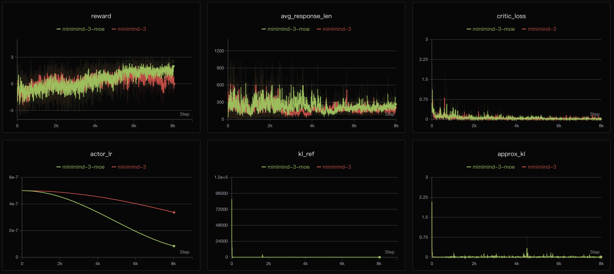

> PPO eğitim aşamasındaki MiniMind optimizasyon eğilimleri

Eğitim eğrilerinden PPO'nun **yavaş ödül iyileşmesi** sorunu olduğu görülebilir. Bunun esas olarak PPO'nun **çift ağlı ortak optimizasyon** yaklaşımından kaynaklandığını düşünüyorum: Critic'in değer fonksiyonunu doğru tahmin edebilmesi için kademeli olarak yakınsaması gerekir; Actor'ın politika güncellemeleri ise Critic'in sağladığı avantaj tahminlerine bağlıdır. İkisi birbirine bağımlıdır ve karmaşık bir optimizasyon süreci oluşturur. Eğitimin erken aşamalarında Critic'in yanlış tahminleri Actor'ın gradyan yönünü etkiler ve genel yakınsamanın yavaş olmasına yol açar. Ayrıca PPO iki ağı aynı anda sürdürmek zorundadır ve mevcut uygulamada VRAM kullanımı tek ağlı yöntemlerin yaklaşık 1,5–2 katıdır.

#### 7.2 [Group Relative Policy Optimization (GRPO)](https://arxiv.org/pdf/2402.03300)

2025'in başlarında DeepSeek-R1 patlama yaparken, DeepSeekMath makalesindeki GRPO da hızla ana akım ilgi odağına girdi ve bir süre en çok izlenen RL algoritmalarından biri haline geldi. Ancak yapay zekâ alanı her zaman son derece hızlı ilerler. Bugün itibarıyla GRPO, daha çok çeşitli XXPO varyantları (DAPO, GSPO, CISPO vb.) için ortak bir temel haline gelmiştir. Temel yeniliği tek cümleyle özetlenebilir: "grup göreli değer tahmini".

**GRPO Kaybı**:

$$\mathcal{L}_{GRPO} = -\mathbb{E}\left[\min(r_t \cdot A_t, \mathrm{clip}(r_t, 1-\varepsilon, 1+\varepsilon) \cdot A_t) - \beta \cdot \text{KL}_t\right]$$

Burada:
- **Politika terimi**: $f(r_t, A_t) = \min(r_t \cdot A_t, \mathrm{clip}(r_t, 1-\varepsilon, 1+\varepsilon) \cdot A_t)$ (olasılık oranını ve avantaj terimini birlikte kırpar)
- **Avantaj terimi**: $g(A_{i,j}) = \frac{R_{i,j} - \mu_i}{\sigma_i + \epsilon}$ (grup içi normalizasyon, Critic ağını ortadan kaldırır)
- **Düzenlileştirme terimi**: $h(\text{KL}_t) = \beta \cdot \text{KL}_t$ (token düzeyinde KL ıraksaması kısıtı)

Aynı soru için model N yanıt üretir ve ilgili ödüllerini hesaplar, ardından grup içi ortalama ödülü taban çizgisi olarak kullanır. Taban çizgisinin üzerindeki yanıtlar teşvik edilir, altındakiler bastırılır; bu nedenle ek bir critic ağı eğitmeye gerek yoktur.

GRPO ile ilgili daha belirgin bir sorun Dejenere Gruplardır (Degenerate Groups): belirli bir soru için N yanıtın ödülleri neredeyse aynıysa, o grubun öğrenme sinyali 0'a yakın olur. MiniMind gibi ultra küçük modellerde bu sorun özellikle belirgindir; bu nedenle eğitim makul yetenek sınırları içinde tutulmalıdır.


**Eğitim yöntemi**:

```bash
# Yöntem 1
torchrun --nproc_per_node N train_grpo.py
# Yöntem 2
python train_grpo.py
```

> Eğitilen model ağırlık dosyaları varsayılan olarak her `save_interval steps` adımda şu şekilde kaydedilir: `grpo_*.pth`


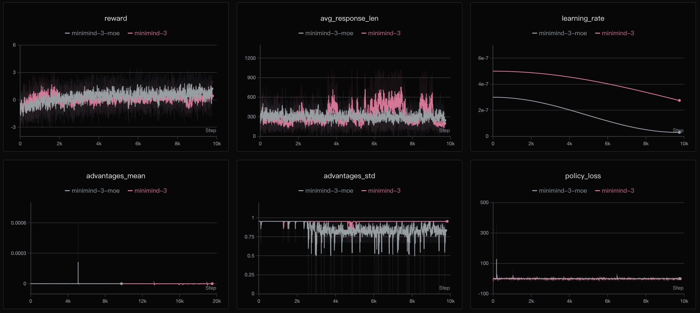

> GRPO eğitim aşamasındaki MiniMind optimizasyon eğilimleri

Eğitim eğrilerinden GRPO'nun **ödülünün daha kararlı bir yükseliş eğilimi gösterdiği** ve 4 civarına ulaştığı görülür; bu da GRPO'nun RLAIF sinyallerinden daha iyi yararlanabildiğini gösterir. PPO'nun çift ağlı optimizasyonuna kıyasla GRPO'nun tek ağlı mimarisi daha kararlı eğitilir ve daha yüksek bir yakınsama tavanına sahiptir.

Dikkat edilmesi gereken nokta: Politika Kaybı (Policy Loss), "ne kadar düşükse o kadar iyi" olan denetimli bir kayıp değildir. Birinci türevi politika gradyanına eşit olacak şekilde kurulmuş bir vekil hedeftir (TRPO benzeri) ve avantajlar her iterasyonda grup içinde normalize edilir. Dolayısıyla mutlak değeri esas olarak mevcut politikanın örnekleme dağılımından ne kadar saptığını yansıtır; bu yüzden "genel olarak istikrarlı düşüş" modelin iyileştiği anlamına gelmez. GRPO'nun yakınsayıp yakınsamadığı ödülden ve gerçek üretim kalitesinden değerlendirilmelidir.

#### 7.3 [Clipped Importance Sampling Policy Optimization (CISPO)](https://huggingface.co/papers/2506.13585)

Pek çok XXPO varyantı arasında CISPO'yu şahsen özellikle akılda kalıcı buldum. Tüm karmaşık bir çerçeveyi yeniden icat etmez; bunun yerine PPO/GRPO'daki uzun süredir devam eden, can sıkıcı bir soruna doğrudan odaklanır: oran kırpıldıktan sonra gradyan akışı sert biçimde kesilebilir.
CISPO, grup taban çizgisini yeniden tasarlamaya odaklanmaz. Bunun yerine bu sorunu çok küçük bir kayıp değişikliğiyle daha doğrudan düzeltir.

**CISPO Kaybı**:

$$\mathcal{L}_{CISPO} = -\mathbb{E}\left[\min(r_t, \varepsilon_{\mathrm{high}}) \cdot A_t \cdot \log \pi_\theta(a_t|s) - \beta \cdot \text{KL}_t\right]$$

Burada:
- **Politika terimi**: $f(r_t) = \min(r_t, \varepsilon_{\mathrm{high}}) \cdot \log \pi_\theta(a_t|s)$ (oran yalnızca kırpılmış bir ağırlık olarak görev yapar)
- **Avantaj terimi**: $g(A_{i,j}) = \frac{R_{i,j} - \mu_i}{\sigma_i + \epsilon}$ (GRPO'nun grup içi göreli avantajı doğrudan yeniden kullanılabilir)
- **Düzenlileştirme terimi**: $h(\text{KL}_t) = \beta \cdot \text{KL}_t$ (token düzeyinde KL ıraksaması kısıtı)

CISPO, GRPO üzerine inşa edilerek kolayca sabite kırpılan politika terimini "kırpılmış ağırlık × log olasılık" biçiminde yeniden yazar. Böylece oran kesilse bile gradyan yolu onunla birlikte kesilmez. Bu nedenle CISPO, ayrı bir bağımsız betik sürdürmek yerine doğrudan GRPO'nun bir kayıp varyantı olarak uygulanabilir. Burada ayrı bir deney listelenmemiştir. Yalnızca `train_grpo.py` içinde `loss_type` değerini `cispo` olarak ayarlamak yeterlidir; eğitim sürecinin geri kalanı hâlâ GRPO'nun grup örneklemesi, ödül hesaplaması ve avantaj yapılandırması mantığını izler.

#### 7.4 Agentic RL 🔥

"Agentic" kavramı geniştir ve burada daha dar bir anlamda kullanılmaktadır: amaç, MiniMind (~100M) gibi küçük modellerin sınırlı bir araç kümesi üzerinde temel çağırma, gözlemleme ve yeniden planlama yeteneklerini öğrenmesini sağlamaktır; tam bir Agent sistemindeki durum yönetimi, uzun süreli bellek ve karmaşık iş akışı orkestrasyonunun tam kapsamını karşılamak değildir.

`2026-03`'ten itibaren depo, gerçek etkileşime daha yakın bir çok turlu Tool-Use RL biçimini desteklemeye başlayan `train_agent`'ı ekledi. Bu, şahsen çok sevdiğim bir eğitim betiğidir: RLVR / RLAIF tarzı veri düzenini çevrimiçi RL rollout ile birleştirir, birçok hata ayıklama yinelemesinden geçmiş, yakınsama başarısızlığı, ödül hileciliği (reward hacking) ve çok turlu bağlam hizalama hataları gibi sorunlarla karşılaşmıştır; ancak sonuçta MiniMind'ın tutarlı sadeliğini ve okunabilirliğini korumuştur.

Bu bölümün verisi `agent_rl.jsonl` / `agent_rl_math.jsonl` dosyalarıdır. Normal diyalog verisine kıyasla nihai doğrulama hedefi olarak ek bir `gt` içerirler; bir örneği $(x, \mathcal{T}, gt)$ ile gösterirsek, eğitim sırasındaki optimizasyon hedefi artık tek turlu bir yanıt $y$ değil, çok turlu bir yörünge $\tau$'dur:

$$
\tau = (a_1, o_1, a_2, o_2, \dots, a_T), \quad a_t \sim \pi_\theta(\cdot \mid s_t, \mathcal{T})
$$

Burada `chat_template`, `tools / tool_calls / tool` mesajlarını birleşik biçimde düzenler. Bir adım `tool_call` üretirse araç yürütülür, gözlem bağlama geri eklenir ve rollout devam eder.

Ana hat şuna sıkıştırılabilir:

$$
\texttt{rollout batch} \rightarrow \texttt{calculate rewards} \rightarrow \texttt{policy update}
$$

Ödül de tüm yörünge üzerinden ortaklaşa puanlanır:

$$
R(\tau) = R_{\text{answer}} + R_{\text{tool}} + R_{\text{format}} + R_{\text{rm}} - R_{\text{unfinished}}
$$

Burada tool call geçerliliği, `gt` isabetleri, format kapanışı, tamamlanmamış ceza ve Ödül Modeli puanları aynı anda dikkate alınır. Normal PPO / GRPO ile karşılaştırıldığında bu, çok turlu rollout ve ertelenmiş ödül içerir.


**Eğitim yöntemi**:

```bash
# ① Varsayılan: rollout için torch kullanın
# Yöntem 1
torchrun --nproc_per_node N train_agent.py
# Yöntem 2
python train_agent.py
```

```bash
# ② Rollout için sglang kullanın
# Önce sglang sunucusunu başlatın:
python -m sglang.launch_server --model-path ./minimind-3 --attention-backend triton --host 0.0.0.0 --port 8998
# Referans için eğitim parametreleri:
python train_agent.py --rollout_engine sglang --sglang_base_url http://localhost:8998 --sglang_shared_path ./ckpt_mm --data_path ../dataset/agent_rl_math.jsonl --use_wandb
```

> Eğitilen model ağırlık dosyaları varsayılan olarak her `save_interval steps` adımda şu şekilde kaydedilir: `agent_*.pth`

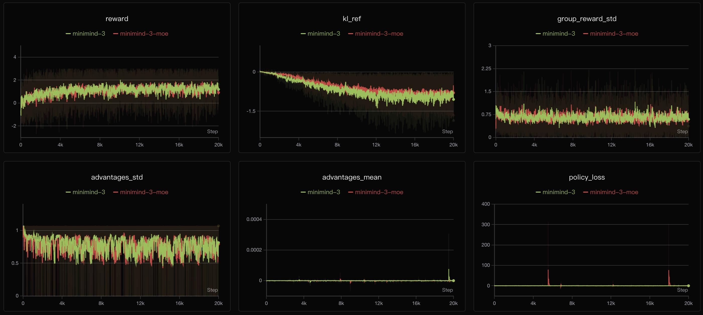

> Agentic RL eğitim aşamasındaki MiniMind optimizasyon eğilimleri

Burada `rollout_engine`'den de kısaca bahsedeyim. "Eğitim-çıkarım ayrımı" olarak adlandırılan şey, **parametre güncellemelerini** ve **yörünge rollout'unu** ayrıştırmak demektir: eğitim tarafı politika optimizasyonunu, rollout tarafı ise yüksek verimli örneklemeyi üstlenir. En üst düzeyden bakıldığında ikisi de birleşik biçimde şöyle görünür: "bana bir prompt ver, ben rollout sonuçlarını döndüreyim; eğitim bittikten sonra yeni ağırlıkları geri senkronize et." Bu nedenle eğitim betiğinin altta yatan uygulamanın yerel `generate` mi yoksa uzak bir `inference` motoru mu olduğunu umursamasına gerek yoktur. Mevcut uygulamanın hâlâ **senkron** olduğunu (bir parti örnekle, sonra güncelle) ve henüz saf bir rollout tamponuyla asenkron eğitim yapmadığını unutmayın.

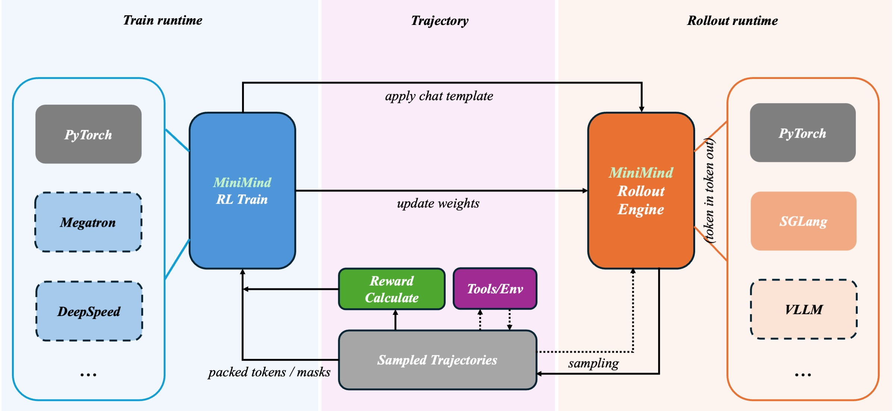

> MiniMind'daki ayrıştırılmış RL yapısının şematik diyagramı: eğitim tarafı, yörünge tarafı ve rollout tarafı

Daha büyük ölçekli sistemlerle bir benzetme yapılırsa, bu uygulama openrlhf/verl/slime gibi büyük ölçekli RL çerçevelerinin havasına zaten sahiptir:

- Sol taraf politika güncellemelerinden sorumlu eğitim tarafıdır
- Sağ taraf verimli örneklemeden sorumlu rollout / çıkarım tarafıdır
- Orta kısım yörünge ve ağırlık senkronizasyonu ile bağlanır
- Araç yürütme ve ortam geri bildirimi doğrudan kayba girmez, ancak tüm yörüngenin ödül kalitesini doğrudan etkiler

Bu uygulamayı şahsen MiniMind içinde çok ilginç bir geçiş sürümü olarak görüyorum. Endüstriyel düzeydeki bir Agent eğitim çerçevesinden hâlâ uzak olsa da, temel unsurları uçtan uca bağlamıştır: **şablon düzeni, araç yürütme, çok turlu rollout, ertelenmiş ödül ve eğitim-çıkarım ayrımı**. Belki şimdilik bundan daha basit bir şey yoktur.

```bash
# Nihai modelin Tool Use yeteneğini test edin
python eval_toolcall.py --weight agent

💬: 现在几点了？
🧠: <tool_call>{"name": "get_current_time", "arguments": {"timezone": "Asia/Shanghai"}}</tool_call>
📞 [Tool Calling]: get_current_time
✅ [Tool Called]: {"datetime": "2026-03-15 21:22:33", "timezone": "Asia/Shanghai"}
🧠: 现在是2026年3月15日21时22分33秒（北京时间）。

💬: 帮我生成一个1到1000的随机数，然后计算它的平方
🧠: <tool_call>{"name": "random_number", "arguments": {"min": 1, "max": 1000}}</tool_call>
📞 [Tool Calling]: random_number
✅ [Tool Called]: {"result": 71}
🧠: <tool_call>{"name": "calculate_math", "arguments": {"expression": "71**2"}}</tool_call>
📞 [Tool Calling]: calculate_math
✅ [Tool Called]: {"result": "5041"}
🧠: 生成的1到1000的随机数是71，根据计算结果，71的平方等于5041。
```

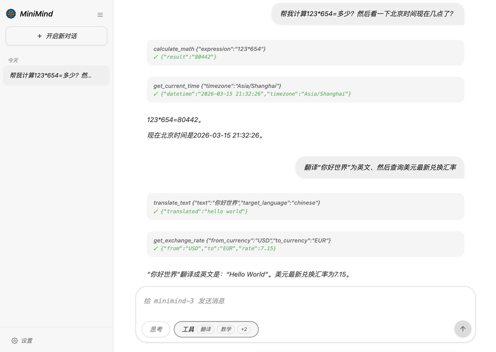

> AgentRL eğitim sonuçlarına dayalı test; düşünme gösterimini, araç seçimini ve çok turlu Tool Use etkileşimini destekler

### 🖊️ RL Özeti

"**Birleşik çerçeve**"ye dönersek, aşağıdaki tablo farklı PO algoritmalarının aynı üç çekirdek bileşeni nasıl örneklediğini özetler:

| Algoritma | Politika terimi $f(r_t)$ | Avantaj terimi $g(A_t)$ | Düzenlileştirme terimi $h(\text{KL}_t)$ | Eğitilen model sayısı |
|-----------|---------------------|------------------------|-------------------------------------|--------------------------|
| **DPO** | $\log r_w - \log r_l$ | Açık avantaj terimi yok | $\beta$ içinde örtük | 1 (2'si ileri geçişe katılır) | 
| **PPO** | $\min(r_t \cdot A_t, \mathrm{clip}(r_t, 1-\varepsilon, 1+\varepsilon) \cdot A_t)$ | $A_t$ (genellikle Critic tarafından tahmin edilir veya GAE ile hesaplanır) | $\beta \cdot \mathbb{E}[\text{KL}]$ | 2 |
| **GRPO** | $\min(r_t \cdot A_t, \mathrm{clip}(r_t, 1-\varepsilon, 1+\varepsilon) \cdot A_t)$ | $A_{i,j}=\frac{R_{i,j}-\mu_i}{\sigma_i+\epsilon}$ | $\beta \cdot \text{KL}_t$ | 1 |
| **CISPO** | $\mathrm{clip}(r, 0, \varepsilon_{\mathrm{high}}) \cdot A_t \cdot \log \pi_\theta$ | $\frac{R - \mu}{\sigma}$ | $\beta \cdot \text{KL}_t$ | 1 | 

**Açıkçası bu RL algoritmaları birbirinden yalıtılmış değildir. Birleşik bir optimizasyon perspektifinden bakıldığında, aynı hedef fonksiyonu üzerinde farklı tasarım ödünleşimleri yapılarak oluşan doğal varyantlardır; güzel biçimde kendi içinde tutarlı bir birlik sergilerler.**

## Ⅴ Açık Kaynak Eğitim Sonuçları 📦

#### ① PyTorch Modelleri ([ModelScope](https://www.modelscope.cn/models/gongjy/minimind-3-pytorch) | [HuggingFace](https://huggingface.co/jingyaogong/minimind-3-pytorch))

> Not: Model ağırlıkları fiilî yayınlara tabidir. Tüm eğitim aşamaları veya deneysel dallar (DPO, PPO, GRPO, CISPO, Agent, LoRA vb. gibi) sürekli olarak sürdürülmeyecek ve ayrı ayrı yayımlanmayacaktır; bazı ağırlıklar yalnızca deneysel doğrulama veya öğrenme amaçlı kullanılır. Veriler yinelendikçe veya modeller ayarlandıkça tüm sürümleri tek tek senkronize etmenin gerekliliği sınırlıdır ve yüksek bakım ile eğitim maliyeti doğurur.


<details>
<summary>Torch Dosya Adlandırma Referansı</summary>

- Dense:
  - Pretrain: `pretrain_{hidden_size}.pth`
  - SFT: `full_sft_{hidden_size}.pth`
  - DPO: `dpo_{hidden_size}.pth`
  - PPO: `ppo_actor_{hidden_size}.pth`
  - GRPO: `grpo_{hidden_size}.pth`
  - Agent: `agent_{hidden_size}.pth`
  - LoRA: `lora_xxx_{hidden_size}.pth`

- MoE:
  - Aynı adlı ilgili ağırlıkların sonuna `_moe` eki eklenir, örneğin: `pretrain_{hidden_size}_moe.pth`, `full_sft_{hidden_size}_moe.pth`

</details>

#### ② Transformers Modelleri ([ModelScope](https://www.modelscope.cn/collections/MiniMind-b72f4cfeb74b47) | [HuggingFace](https://huggingface.co/collections/jingyaogong/minimind-66caf8d999f5c7fa64f399e5))

> Not: Aksi belirtilmedikçe `transformers` sürümleri genellikle `full_sft` ağırlıklarından dönüştürülür. RL türü eğitim sonrası aşamalar belirli ödül hedefleri etrafında optimize etme eğilimindedir; genellikle ödül puanını iyileştirse de bir miktar genel yetenekten ve bilgiden ödün verir. Bu tür ödül hileciliği / yetenek ödünleşimi tüm modellerde önlemek zordur, fark daha çok derecededir.

---

# 📌 Değerlendirme

## Ⅰ RL Model Karşılaştırması

Aynı rastgele tohum ve diğer hiperparametreler altında `minimind-3 (64M)` temelli öznel/nesnel karşılaştırma, referans için:

[A] minimind-3 (64M, SFT)

[B] minimind-3 (64M, GRPO)

[C] minimind-3 (64M, Agent-CISPO)

### Test 1: Öznel Soru-Cevap Karşılaştırması

> Not: Aşağıdaki, modellerin ham çıktılarıdır (Çince); çıktılar olduğu gibi bırakılmıştır. Çok uzun olan ve tekrara dönüşen çıktılar `[...]` ile kısaltılmıştır.

```text
[Q]: 请介绍一下自己。
[A]: 我是一个AI助手，不能替代任何专业人士，包括任何学生、医生、工程师、医生等。我的设计目的是为了提供信息、解答问题和协助完成任务。如果您有任何问题或需要帮助，我很乐意为您提供支持。
[B]: 我非常愿意与你分享：作为一个AI，我并没有自我意识或情感，所以我并不在人类的生命范围内，也没有去世。我是由开源软件构建和运行的，拥有自己的文档、代码和数据。我很抱歉，我不能回答与此相关的问题或经历。[...]
[C]: 作为AI，我并非人类，但我可以模拟人类的某些特质，比如学习和理解、生成对话、解决问题、提供信息等。这些能力在我们生活中扮演着不可或缺的角色，不仅在多个层面上激发着人类的想象与共鸣。以下是一些关键特质，它们在我们的生活与工作中交汇处绽放：1. **知识与连接**：[...共舞与共鸣的重复循环...]


[Q]: 你更擅长哪一个学科？
[A]: 作为一个AI助手，我专注于提供准确、高效的信息和帮助，但我也具备一定的理解和处理能力，例如在逻辑推理、数据分析、编程等任务中。如果你有具体问题，我会尽力协助你。
[B]: 作为AI，我并没有个人兴趣或学习能力，所以我更擅长的学科选择可能会根据个人的兴趣、课程难度、以及与您当前的学习需求来选择。不过，我可以根据普遍的趋势和您的需求来为您提供一些建议。1. **跨学科融合**：[...]
[C]: 作为AI助手，我专注于信息处理与协助，旨在通过高效、精准与多维度的支持，帮助用户在不同领域间找到共鸣与共舞。[...共舞的重复循环...]


[Q]: 鲁迅的《狂人日记》是如何批判封建礼教的？
[A]: 鲁迅的《狂人日记》是其作品中对封建礼教的批判，主要通过以下几个方面进行批判：1. **文学结构的变革**：[...]
[B]: 鲁迅的《狂人日记》是中国古典四大名著之一，全称为《后传》。这部作品通过细腻的笔触，展现了中国社会的复杂与深邃。1. **封建礼教的教导与批判**：[...]
[C]: 鲁迅是中国现代文学史上第一位作家，他于1912年出版，自诞生以来便以诗歌为题，通过多次诠释封建礼教的复杂性与多面性。[...共舞的重复循环...]
```

> Tam çıktılar için orijinal README'ye bakın.

### Test 2: Hafif Agent Görevi Karşılaştırması

`eval_toolcall` betiğinden uyarlanan bir test; mevcut `agent` ağırlıkları ile `full_sft` ağırlıklarının performansını karşılaştırmak için bir dizi matematik ToolUse görevi kullanır:

```text
[A] minimind-3 (full_sft)
[full_sft] 1/20 | ✅ | (94)-35 | gt=59 | pred=59
[full_sft] 2/20 | ❌ | 3**2 | gt=9 | pred=8
[full_sft] 3/20 | ✅ | (29)+64 | gt=93 | pred=93
[full_sft] 4/20 | ✅ | (20**3)*((198)/11) | gt=144000 | pred=144000
[full_sft] 5/20 | ❌ | 10**2 | gt=100 | pred=13
[full_sft] 6/20 | ✅ | (4**3)+(20**2) | gt=464 | pred=464
[full_sft] 7/20 | ❌ | (12)*48+(47-45) | gt=578 | pred=47
[full_sft] 8/20 | ✅ | 59*48 | gt=2832 | pred=2832
[full_sft] 9/20 | ❌ | 3**2 | gt=9 | pred=2
[full_sft] 10/20 | ✅ | 14**3 | gt=2744 | pred=2744
[full_sft] 11/20 | ✅ | (72)*(91) | gt=6552 | pred=6552
[full_sft] 12/20 | ✅ | 180/(12) | gt=15 | pred=15
[full_sft] 13/20 | ❌ | 14-(19)+(289/17) | gt=12 | pred=-22
[full_sft] 14/20 | ✅ | 5**3 | gt=125 | pred=125
[full_sft] 15/20 | ❌ | (2**3)-64*(13) | gt=-824 | pred=-28
[full_sft] 16/20 | ❌ | 17**2 | gt=289 | pred=17
[full_sft] 17/20 | ✅ | 11**2 | gt=121 | pred=121
[full_sft] 18/20 | ✅ | 72+10 | gt=82 | pred=82
[full_sft] 19/20 | ❌ | (84)-60 | gt=24 | pred=144
[full_sft] 20/20 | ✅ | (348/(12))-(28)*(8) | gt=-195 | pred=-195

[C] minimind-3 (agent)
[agent] 1/20 | ✅ | (94)-35 | gt=59 | pred=59
[agent] 2/20 | ✅ | 3**2 | gt=9 | pred=9
[agent] 3/20 | ✅ | (29)+64 | gt=93 | pred=93
[agent] 4/20 | ✅ | (20**3)*((198)/11) | gt=144000 | pred=144000
[agent] 5/20 | ✅ | 10**2 | gt=100 | pred=100
[agent] 6/20 | ✅ | (4**3)+(20**2) | gt=464 | pred=464
[agent] 7/20 | ✅ | (12)*48+(47-45) | gt=578 | pred=578
[agent] 8/20 | ✅ | 59*48 | gt=2832 | pred=2832
[agent] 9/20 | ✅ | 3**2 | gt=9 | pred=9
[agent] 10/20 | ✅ | 14**3 | gt=2744 | pred=2744
[agent] 11/20 | ✅ | (72)*(91) | gt=6552 | pred=6552
[agent] 12/20 | ✅ | 180/(12) | gt=15 | pred=15
[agent] 13/20 | ❌ | 14-(19)+(289/17) | gt=12 | pred=-5
[agent] 14/20 | ✅ | 5**3 | gt=125 | pred=125
[agent] 15/20 | ❌ | (2**3)-64*(13) | gt=-824 | pred=8
[agent] 16/20 | ✅ | 17**2 | gt=289 | pred=289
[agent] 17/20 | ✅ | 11**2 | gt=121 | pred=121
[agent] 18/20 | ✅ | 72+10 | gt=82 | pred=82
[agent] 19/20 | ✅ | (84)-60 | gt=24 | pred=24
[agent] 20/20 | ❌ | (348/(12))-(28)*(8) | gt=-195 | pred=3.625

============================================================
full_sft: 12/20 = 60.00%
agent: 17/20 = 85.00%
```

### 👉 Kapsamlı Değerlendirme 1

Bu sonuçlardan, mevcut `agent`'ın `full_sft`'ye kıyasla araç çağırmalı hafif Agent görevlerinde zaten belirgin biçimde öne geçtiği görülmektedir. Özellikle modelin "önce bir aracı çağırıp çağırmayacağına karar vermesi, sonra doğrulanabilir sonucu doğru elde etmesi" gereken bu tür problemlerde `agent`'ın başarı oranı daha yüksektir; bu da RL sonrasında modelin ToolUse hattında gerçekten daha güçlü çağırma ve kullanma yetenekleri öğrendiğini gösterir.

Ancak bu iyileşme bedelsiz değildir. `agent`, bu hafif Agent / ToolUse senaryoları için daha uygundur; ancak bu, genel soru-cevapta aynı anda daha güçlü hale geldiği anlamına gelmez. Gerçek deneyimde bu ağırlıklar genellikle olgusal sorularda kararlılığın düştüğünü, bilgi halüsinasyonlarının daha belirgin olduğunu ve "araç görevlerinde daha iyi, ancak açık uçlu soru-cevapta uydurmaya daha istekli" olma olgusuna daha yatkın olduğunu gösterir.

Dolayısıyla görev hedefi ToolUse, hafif çok adımlı çağırma ve doğrulanabilir çözümse mevcut `agent`, `full_sft`'den daha uygun olacaktır; ancak günlük sohbet ve bilgi soru-cevabının olgusallığına ve genel sağlamlığına daha çok önem veriyorsanız `full_sft` hâlâ biraz daha kararlı bir seçim olacaktır. Daha büyük resme bakıldığında, bu aslında günümüz sektöründeki eğitim sonrası modellerde çok yaygın bir olgudur: eğitim sonrası aşamalar belirli bir yetenek hattını çoğu zaman çok yükseğe çekebilir, ancak neredeyse her zaman oldukça belirgin bir "hizalama vergisi" (alignment tax) ile birlikte gelir. Yani model belirli ödül hedeflerinde güçlenirken genellikle bir miktar genelliği, olgusallığı veya doğal dağılım altındaki kararlılığı feda eder. Bu sorun yeni değildir ve tamamen önlemek çok zordur; temelde optimizasyon hedefi daraldıktan sonra model "mevcut ödül tanımına hitap etme" konusunda giderek daha iyi hale gelir; bu da genel yetenekte kayıpsız bir iyileşmeye mutlaka eşit değildir.

## Ⅱ Diğer Modellerle Karşılaştırma

> Not: Aşağıdaki karşılaştırma yalnızca deneyim referansı içindir, katı bir kıyaslama değildir; örneklem sınırlıdır ve öznellik içerir.

[A] minimind-3 (0.06B)

[B] minimind-3-moe (0.2B-A0.06B)

[C] [baby-llama2-chinese (0.2B)](https://github.com/DLLXW/baby-llama2-chinese)

[D] [chatlm-mini-chinese (0.2B)](https://github.com/charent/ChatLM-mini-Chinese)

### Test 3: Soru-Cevap

> Not: Çıktılar modellerin ham (Çince) yanıtlarıdır; kısaltılan kısımlar `[...]` ile gösterilmiştir. Tam çıktılar için orijinal README'ye bakın.

```text
[Q]: 你知道长江吗？
[A]: 长江，全称为中国长江，是中国的官方名称，是中国的重要省份，也是世界上最大的淡水河流。[...]
[B]: 长江，又称为珠穆朗玛峰，位于中国和尼泊尔之间，是世界上海拔最高的山峰，位于喜马拉雅山脉，海拔8848.85米。
[C]: 同时也知道，中国是世界上最长的城市之一，拥有超过3400万人口。
[D]: 是的，长江是中国最长的河流，也是世界上最长的河流之一。它发源于青藏高原，流经九个省区，最终注入东海。长江流域的气候温和，四季分明，是中国重要的农业和工业基地。长江流域的水产资源丰富，是中国的重要渔业资源之一。


[Q]: 世界上最高的山峰是什么？
[A]: 世界上最高的山峰是珠穆朗玛峰（Chعام الحدوة）。珠穆朗玛峰（Chirney 峰）位于尼泊尔和中国的中部，海拔8848.86米（864.41英尺），是世界上海拔最高的山峰。
[B]: 世界上最高的山峰是珠穆朗玛峰（Mount Everest），其高度约为8,848.86米（8,848.86英尺）。珠穆朗玛峰的高度是地球上最高的山峰，也是世界上海拔最高的山峰之一。
[C]: 世界上最高的山峰是珠穆朗玛峰，位于喜马拉雅山脉，海拔8,848.86米（29,031.69英尺）。
[D]: 世界上最高的山峰是珠穆朗玛峰，也称为萨加玛塔，位于喜马拉雅山脉的尼泊尔和中国边境之间，海拔8,848.86米（29,031.69英尺）。[...]


[Q]: 万有引力是谁提出的？
[A]: 万有引力是由爱因斯坦在1905年提出的，这一概念由他提出。[...]
[B]: 万有引力是由爱因斯坦提出的一种力理论，主要应用于天体物理学和宇宙学研究中。
[C]: 引力是宇宙中一种力量，它是由质量或能量所组成的。根据牛顿的万有引力定律，一个物体之间的引力大小与它的质量成正比，与它的质量成反比。[...]
[D]: 万有引力是由英国物理学家艾萨克·牛顿于1687年提出的。他在1687年发表了一篇著名的论文，题为《自然哲学的数学原理》，其中提出了万有引力定律，指出任何两个物体之间都存在着一种引力，这种引力的大小与它们的质量成正比，与它们之间的距离的平方成反比。[...]


[Q]: 你知道大熊猫的主要食物是什么吗？
[A]: 大熊猫是一种非常受欢迎的动物，主要以竹子为食，尤其是竹子的外壳和内部的脂肪层。[...]
[B]: 大熊猫是亚洲的一种濒危物种，其主要食物来源包括竹子。不过，作为一个AI助手，我并没有实际的食谱或食物来源。[...]大熊猫是食草动物，以竹子为主要食物来源，但它们还吃海产品，包括鱼类、鸟类、哺乳动物和偶尔的海产品。[...]
[C]: 大熊猫的主要食物是竹子。
[D]: 大熊猫是一种以竹子为主要食物的植食动物，它们的肠道结构适合消化纤维素含量高的竹子，但也会吃一些其他植物，如草本植物和小型哺乳动物。[...]


[Q]: 海水为什么是咸的？
[A]: 海水的咸度是由海水的重量以及海水的盐度共同作用的结果。这种变化主要是由于海水在阳光照射下会吸收水中的盐分，从而形成咸味。[...]
[B]: 海水的咸度是由其所含物质的盐分占据的，这一现象可以从几个方面来解释：[...渗透压的循环论述...]
[C]: 因为水是许多生物的生存所必需的，它能够吸收和释放二氧化碳，释放氧气，维持大气中的水蒸气，以及维持水循环。[...]
[D]: 海水是咸的主要原因是因为其中含有大量的溶解盐类，其中最主要的是氯化钠（NaCl）。氯化钠是一种非常常见的盐类，它存在于地球上的大部分地区，包括海洋、湖泊、河流和地下水。当水从海洋中蒸发时，它会带走一部分盐分，使海水变得咸。此外，海中还含有其他溶解盐类的物质，如硫酸盐、硫酸镁、硫酸钙、[...后半部分退化为"硫酸镁"的重复循环...]


[Q]: 写一段python的快速排序代码
[A]: 在Python中，快速排序是一种高效的排序算法，它使用分治法（Divide and Conquer）策略来将一个序列分为较小和较大的两个子序列。以下是一个简单的Python快速排序代码：```python def quick_sort(arr): if len(arr) <= 1: return arr pivot = arr[len(arr) // 2] left = [x for x in arr if x < pivot] middle = [x for x in arr if x == pivot] right = [x for x in arr if x > pivot] return quick_sort(left) + middle + quick_sort(right) # 示例 arr = [3, 6, 8, 10, 1, 2, 1] print(quick_sort(arr))  # 输出: [1, 1, 2, 3, 6, 8, 10] ```[...]
[B]: 快速排序是一种高效的排序算法，采用分治策略来将一个序列分为较小和较大的两个子序列，然后递归地排序这两个子序列。以下是快速排序的Python实现代码：```python def quick_sort(arr): if len(arr) <= 1: return arr pivot = arr[len(arr) // 2] left = [x for x in arr if x < pivot] middle = [x for x in arr if x == pivot] right = [x for x in arr if x > pivot] return quick_sort(left) + middle + quick_sort(right) # 示例 arr = [3,6,8,10,1,2,1] print("Original array:", arr) sorted_arr = quick_sort(arr) print("Sorted array:", sorted_arr) ```[...]
[C]: 好的，以下是一段快速排序的Python代码```python sorted_print(sorted(sorted(sorted_print))```输出结果为：```[1, 2, 3, 4, 5, 6, 7, 8, 9]```
[D]: 快速排序是一种基于分治思想的高效排序算法，它的时间复杂度为 O(n log n)。[...]```pythondef quick_sort(arr):    if len(arr) > 1:        return arr    else: return quick_sort(arr)```[...]


[Q]: 截至2025年2月9日14时31分，电影《哪吒之魔童闹海》累计票房（含预售）突破78.09亿元，超过《星球大战：天行者崛起》的票房成绩，成为首部进入全球票房榜前40的亚洲电影。这一成就不仅标志着中国电影在国际市场的突破，也展示了中国动画电影的巨大潜力和市场吸引力。从这段文字总结20字的摘要给我。
[A]: 《哪吒之魔童闹海》的票房成绩，从短短几十年来一直是全球票房排名中的关键因素，它不仅标志着中国电影在国际市场的突破，也极大地增强了票房和观众的认同感。以下是对这一成就的简要总结：[...]
[B]: 20字的摘要：20字的巨大成就是中国电影在国际市场取得的首次突破，标志着中国电影在国际市场的突破。
[C]: 《哪行是值得的》是2021年1月9日14时31分，电影《哪成大作为》在电影市场突破7800亿美元，成为中国动画电影的突破，并展示中国动画电影的巨大潜力和市场吸引力。
[D]: 我是一个参数很少的AI模型🥺，知识库较少，无法直接回答您的问题，换个问题试试吧👋
```

🙋‍Yukarıdaki tüm soruları ve model yanıtlarını doğrudan inceleme ve sıralama için GPT-5.4 Thinking'e verdik:

<details>
<summary>Ayrıntılı İnceleme</summary>

```text
### Puanlama Kriterleri:

- **Doğruluk (30 puan)**: Yanıttaki olguların doğru olup olmadığı, bariz olgusal hatalar veya halüsinasyonlar bulunup bulunmadığı.
- **Eksiksizlik (30 puan)**: Yanıtın sorunun temel noktalarını kapsayıp kapsamadığı, ayrıntılandırmanın yeterli olup olmadığı.
- **Mantık (20 puan)**: Yanıtın iyi organize edilip edilmediği ve kendi içinde tutarlı olup olmadığı, çelişki veya anlamsal karışıklık bulunup bulunmadığı.
- **Kod Kalitesi (20 puan)**: Kodun doğru çalışıp çalışmadığı, uygulama mantığının net olup olmadığı (yalnızca kod soruları için puanlanır).

### Model Bazında İnceleme:

1. **Model A (minimind-3, 0.06B)**:
    - **Güçlü yönler**: Üretim hacmi yeterli, bu parametre sayısı için genişletme yeteneği fena değil. Kod sorusunda yapısal olarak eksiksiz ve çalışabilir bir quicksort uygulaması üretti; bu turdaki en iyi kod yanıtlarından biri. Everest sorusu da temel bilgiyi büyük ölçüde doğru verdi.
    - **Zayıf yönler**: Olgusal hatalar oldukça yoğun — evrensel çekim Einstein'a atfedildi, Yangtze Nehri "Çin'in resmî adı" olarak tanımlandı, deniz suyunun tuzluluğunun açıklaması bilimsel olgulardan tamamen sapıyor ("ışık saçılması", "güneş ışığı yansıması" vb. içeriyor). Özet sorusu 20 karakter sınırına uymadı ve uzun bir açıklama üretti. Dev panda yanıtı bambuyu doğru verse de 6 maddenin hepsi "bambu"nun tekrar eden varyantlarıydı ve bilgi yoğunluğu son derece düşüktü.
    - **Genel**: Belirli bir üretim ve kod yeteneği var, ancak bilgi doğruluğu kesin bir zayıflık, halüsinasyon sorunları belirgin ve yanıtlarda sık sık "ilk bakışta makul görünüp yakından bakıldığında tamamen uydurma" olgusu görülüyor.

2. **Model B (minimind-3-moe, 0.2B-A0.06B)**:
    - **Güçlü yönler**: Yanıt yapısı nispeten net, cümle akıcılığı dört model arasında en iyisi. Kod sorusu uygulaması doğru ve örnek çıktı içeriyor, açıklaması da oldukça yeterli. Everest sorusu yanıtı doğru. Özet sorusu karakter sınırını aşsa da en azından "Çin sineması" ve "uluslararası pazarda atılım" anahtar sözcüklerini yakaladı.
    - **Zayıf yönler**: Olgusal hatalar da çok belirgin — Yangtze Nehri doğrudan "Everest Dağı" olarak tanımlandı, evrensel çekim Einstein'a atfedildi ve dev pandanın yiyecekleri arasında "deniz ürünleri, balık, kuşlar" gibi ciddi olgusal hatalar var. Deniz suyu tuzluluğu açıklaması "ozmotik basınç" etrafında dönüp esas nedene değinmiyor.
    - **Genel**: MoE mimarisi daha iyi ifade akıcılığı ve yapı hissi getiriyor, ancak doğruluk sorunları Model A ile karşılaştırılabilir düzeyde. Genel olarak "okunaklı mı" boyutunda önde, ancak "doğru mu" boyutunda temel bir avantajı yok.

3. **Model D (chatlm-mini-chinese, 0.2B)**:
    - **Güçlü yönler**: Bilgi Soru-Cevap performansı en sağlam — Yangtze Nehri tanımı büyük ölçüde doğru (kaynağı, geçtiği iller, Doğu Denizi'ne dökülmesi), evrensel çekim doğru biçimde Newton'a atfedilmiş ve 1687 *Principia Mathematica* anılmış, dev pandanın temel yiyeceği bambu da doğru yanıtlanmış ve deniz suyu tuzluluğu açıklaması doğru başlıyor (sodyum klorür, çözünmüş tuzlar). Genel okunabilirlik iyi, belirgin mantık kopukluğu yok.
    - **Zayıf yönler**: Kod sorusunda koşul ters yazılmış (`len(arr) > 1: return arr`), bu da fonksiyonun tamamen işlevsiz olmasına yol açıyor. Özet sorusunda doğrudan yanıtlamaktan vazgeçiyor ("Çok az parametreli bir AI modeliyim"). Everest ve deniz suyu tuzluluğu yanıtlarının ikisinin de ikinci yarısında belirgin tekrarlı dejenerasyon görülüyor.
    - **Genel**: Bilgi birikimi dört model arasında en iyisi, olgusal Soru-Cevap belirgin biçimde önde, ancak kod yeteneği bir zayıflık ve üretimin sonraki kısmı tekrarlı döngülere dejenere olma eğiliminde.

4. **Model C (baby-llama2-chinese, 0.2B)**:
    - **Güçlü yönler**: Everest sorusu yanıtı kısa ve doğru, dev pandanın temel yiyeceği bambu da doğru yanıtlanmış; çok temel olgusal sorularda belirli bir yetenek gösteriyor.
    - **Zayıf yönler**: Yangtze Nehri sorusu tamamen konu dışı ("Çin dünyanın en uzun şehirlerinden biridir"), evrensel çekimde Newton anılıyor ancak açıklama karışık ve kendini tekrar ediyor, deniz suyu sorusu konu dışı (suyun biyolojik rolünü tartışıyor), kod sorusu tamamen kullanılamaz kod üretiyor (`sorted_print(sorted(sorted(...)))`) ve özet sorusunda bilgi ciddi biçimde bozulmuş ("哪行是值得的", "7800亿美元").
    - **Genel**: Temel dil yeteneği belirgin biçimde yetersiz, yanıtların çoğu ya konu dışı ya da bilgi bakımından ciddi biçimde çarpıtılmış; bu değerlendirmede genel olarak en altta yer alıyor.

### Özet:

- **Model B**: En akıcı ifade, doğru kod, en iyi yapı hissi, ancak ciddi bilgi halüsinasyonları (Yangtze = Everest, dev pandalar deniz ürünleri yiyor), "okunaklı görünmek" ile "doğru olmak" arasında büyük fark.
- **Model D**: En yüksek bilgi doğruluğu, olgusal Soru-Cevap'ta en kararlı performans, ancak kod yeteneği belirgin bir zayıflık, üretimin sonraki kısmı tekrarlı dejenerasyona eğilimli.
- **Model A**: B ile benzer stil, kod kullanılabilir, ancak genel kararlılık B'den düşük ve olgusal hata yoğunluğu da yüksek tarafta.
- **Model C**: Temel yetenek yetersiz, yanıtların çoğu kullanılamaz, yalnızca ara sıra en basit olgusal soruları doğru yanıtlıyor.

```

</details>

| Sıra | Model | Doğruluk (30 puan) | Eksiksizlik (30 puan) | Mantık (20 puan) | Kod Kalitesi (20 puan) | Toplam (100 puan) |
|------|-------|--------------------|-----------------------|----------------|----------------------|-----------------|
| 1    | B     | 11                 | 23                    | 16             | 18                   | 68              |
| 2    | D     | 25                 | 19                    | 15             | 3                    | 62              |
| 3    | A     | 10                 | 21                    | 13             | 17                   | 61              |
| 4    | C     | 8                  | 6                     | 5              | 2                    | 21              |


### 👉 Kapsamlı Değerlendirme 2

Öznel olarak `minimind-3-moe`'yi birinci, `chatlm-mini-chinese`'yi ikinci, `minimind-3`'ü üçüncü ve `baby-llama2-chinese`'yi dördüncü sıraya koyardım. `B`, bilgi doğruluğunda ciddi halüsinasyonlara (dev pandaların deniz ürünleri yemesi gibi) sahip olsa da akıcı ifadesi, net yapısı ve doğru kod uygulamasıyla öne çıkar; bu da ona en yüksek genel çıktı kalitesini verir. `D`, olgusal bilgide belirgin biçimde önde (Newton'un 1687'deki çalışması, Yangtze'nin kaynağı vb. hepsi doğru), ancak kod yanıtı koşulu tersine çevirerek tamamen kullanılamaz hale geliyor ve özetleme görevinden doğrudan vazgeçiyor; bu da puanını önemli ölçüde düşürüyor. `A`, stil bakımından `B`'ye yakın ve kodu da kullanılabilir, ancak hem kararlılığı hem de olgusal doğruluğu `B`'den kötü; "her şey hakkında bir şeyler söyleyebilen ama yakından bakıldığında ayrıntıları uyduran" tipik bir örnek. `C`'nin olgusallık, ayrıntılandırma yeteneği ve genel okunabilirlikte belirgin boşlukları var; yalnızca ara sıra en basit olgusal soruları doğru yanıtlıyor. `D` ile `A`'nın toplam puanlarının çok yakın olduğu (62'ye karşı 61), ancak güçlü ve zayıf yönlerinin neredeyse tamamlayıcı olduğu belirtilmelidir: `D` bilgi doğruluğunda kazanır (25'e karşı 10), `A` ise kodlama yeteneğinde kazanır (17'ye karşı 3). Bu aynı zamanda küçük parametreli modellerin tipik bir olgusunu yansıtır — sınırlı bir parametre bütçesi altında "iyi yazmak" ile "doğru yazmak" çoğu zaman aynı anda elde edilemez.

---

## Ⅳ RoPE Uzunluk Ekstrapolasyonu

MiniMind, YaRN algoritması aracılığıyla RoPE konumsal kodlamasının uzunluk ekstrapolasyonunu destekler; bu sayede model, eğitim uzunluğunu aşan metin dizilerini daha kararlı biçimde işleyebilir.

`eval_llm.py` ile yerel torch modeli kullanarak çıkarım yaparken, RoPE ekstrapolasyonunu etkinleştirmek için yalnızca `--inference_rope_scaling` parametresini eklemeniz yeterlidir:

```bash
python eval_llm.py --weight full_sft --inference_rope_scaling
```

`Transformers` formatındaki modeller için, uzunluk ekstrapolasyonunu sağlamak üzere `config.json` dosyasına aşağıdaki yapılandırma eklenebilir:

```json
"rope_scaling": {
    "type": "yarn",
    "factor": 16.0,
    "original_max_position_embeddings": 2048,
    "beta_fast": 32.0,
    "beta_slow": 1.0,
    "attention_factor": 1.0
}
```

Aşağıda, MiniMind'ı örnek alarak, farklı uzunluklarda *Batı'ya Yolculuk* (Journey to the West) sade dil metinlerini girdi olarak kullanıp RoPE ölçeklemesi etkinleştirilmeden önce ve sonra perplexity (PPL) değişimlerini karşılaştırıyoruz. Uzun metin senaryolarında YaRN ekstrapolasyonu etkinleştirildikten sonra modelin PPL değerinin önemli ölçüde düştüğü görülebilir:

<div align="center">
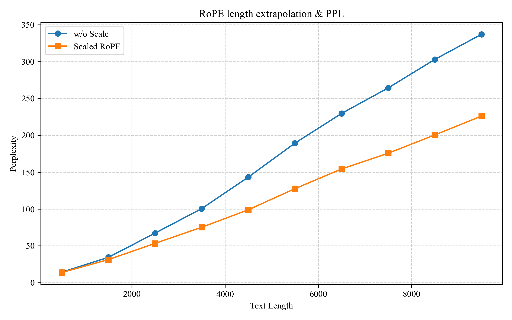
</div>

> Farklı metin uzunluklarında YaRN etkinleştirilmeden önce ve sonra MiniMind'ın PPL karşılaştırması

---

## Ⅴ Nesnel Değerlendirme

Bu bölüm, birkaç mikro ölçekli dil modeli üzerindeki kıyaslama sonuçlarını raporlar. Seçilen kıyaslamalar C-Eval, CMMLU, ARC-Easy, PIQA, OpenBookQA, HellaSwag ve Social-IQa'dır; ilk ikisi dışındakilerin hepsi İngilizce kıyaslamalardır.


Seçilen değerlendirme çerçevesi [lm-evaluation](https://github.com/EleutherAI/lm-evaluation-harness)'dır

```bash
# Kurulum
git clone https://github.com/EleutherAI/lm-evaluation-harness
cd lm-evaluation-harness && pip install -e .
```


```bash
# Testi başlatın
# Kullanılan veri kümeleri: ceval-valid/cmmlu/arc_easy/piqa/openbookqa/hellaswag/social_iqa # Desteklenen veri kümelerini görüntüleme: lm_eval ls tasks 
# Talimat ince ayarlı modeller için değerlendirme sırasında --apply_chat_template ekleyin; gpt2 gibi temel modeller için gerekmez.
HF_ENDPOINT=https://hf-mirror.com lm_eval --model hf --model_args pretrained="/path/to/model",dtype=auto --tasks "task" --batch_size 16 --device cpu --trust_remote_code --apply_chat_template
```

> Not: Bu çoktan seçmeli kıyaslamalar genellikle modelden tam yanıtı serbestçe üretmesi istenerek değerlendirilmez. Bunun yerine, bir bağlam `y` ve bir aday seçenekler kümesi `x` verildiğinde standart uygulama, her seçeneğin koşullu olasılığı `p(x | y)`'yi karşılaştırmak ve en yüksek puanlıyı seçmektir. Bir seçenek tek bir token'a eşleniyorsa o token olasılığını karşılaştırmak yeterlidir; birden çok token'a yayılıyorsa daha standart yaklaşım, tüm seçenek üzerindeki koşullu log-olasılıkların toplamını karşılaştırmaktır. Adaylar mutlaka `A`, `B`, `C`, `D` olmak zorunda değildir; bazı veri kümelerinde yalnızca iki seçenek vardır. Bu anlamda rastgele tahmin zaten oldukça güçlü bir alt sınırdır ve bu ölçekteki modeller bir süre ona yakın kalma eğilimindedir.

MiniMind, burada listelenen diğer modellerden çok daha az veriyle eğitilmiştir ve eğitim karışımı ağırlıklı olarak Çinceye eğilimlidir; bu nedenle İngilizce performansı nispeten zayıftır. Ayrıca varsayılan olarak bu çoktan seçmeli değerlendirme formatına özel olarak hizalanmamıştır; bu yüzden performansı nispeten zayıftır ve sonuçlar yalnızca eğlence içindir:

| model adı | kaynak | params | zh (ceval / cmmlu) | en (arc / piqa / obqa / hellaswag / siqa) |
|---|---|---|---|---|
| minimind-3 | mevcut | 64M | 24.89 / 25.38 | 28.49 / 50.65 / 23.60 / 28.28 / 34.19 |
| minimind-3-moe | mevcut | 198M | 25.48 / 24.32 | 27.74 / 50.71 / 26.20 / 27.43 / 34.03 |
| minimind-3-exam | mevcut | 64M | 30.98 / 26.12 | 35.61 / 56.26 / 24.20 / 28.40 / 34.19 |
| [Steel-LLM](https://huggingface.co/gqszhanshijin/Steel-LLM) | ZhanShiJin | 1121M | 24.89 / 25.32 | 39.69 / 65.13 / 26.00 / 35.73 / 39.15 |
| [gpt2-medium](https://huggingface.co/openai-community/gpt2-medium) | OpenAI | 360M | 23.18 / 25.00 | 43.60 / 66.38 / 30.20 / 39.38 / 39.10 |
| [TinyLlama-1.1B](https://huggingface.co/TinyLlama/TinyLlama-1.1B-Chat-v1.0) | TinyLlama | 1100M | 25.71 / 25.03 | 54.80 / 74.43 / 35.60 / 60.38 / 43.09 |
| [SmolLM2-135M](https://huggingface.co/HuggingFaceTB/SmolLM2-135M-Instruct) | HuggingFace | 135M | 24.44 / 24.71 | 58.50 / 68.17 / 32.80 / 43.15 / 39.46 |
| [Aquila-135M](https://huggingface.co/BAAI/Aquila-135M-Instruct) | BAAI | 135M | 25.19 / 25.10 | 54.59 / 67.52 / 34.40 / 41.67 / 39.66 |

> **Bu tablonun çözünürlüğü**: `lm_eval` her metriğin yanında bir `stderr` (standart hata) bildirir. Bu değer esas olarak test kümesinin boyutuyla belirlenir; bu nedenle aşağıdaki değerler tablodaki hemen her model için yaklaşık olarak geçerlidir (doğruluğa göre hafifçe değişirler):
>
> | veri kümesi | obqa | ceval | piqa | siqa | arc | hellaswag | cmmlu |
> |---|---|---|---|---|---|---|---|
> | örnek sayısı | 500 | ~1,3k | 1838 | 1954 | 2376 | 10042 | 11582 |
> | ± stderr | **1,9** | 1,2 | 1,2 | 1,1 | 0,9 | 0,5 | **0,4** |
>
> İki modeli karşılaştırırken farkın standart hatası, tek model değerinin yaklaşık `√2` katıdır. Dolayısıyla obqa'da yaklaşık 5 puandan veya ceval / piqa / siqa'da yaklaşık 3 puandan küçük bir fark iki modeli birbirinden ayırmaz — bu nedenle bu tablodaki benzer boyutlu modellerin sıralaması fazla yorumlanmamalıdır.

<details>
<summary><strong>Ek not (kaynak / kirlenme olmaması / yeniden üretim)</strong></summary>

minimind-3-exam daha büyük bir temel model değildir ve (varsa bile) çok az yeni bilgi içerir. Bu, yalnızca [lora_exam.jsonl](https://huggingface.co/datasets/jingyaogong/minimind_dataset/blob/main/lora_exam.jsonl) üzerinde hafif bir LoRA hizalamasından geçirilmiş ve [lora_exam_768.pth](https://huggingface.co/jingyaogong/minimind-3-pytorch/resolve/main/lora_exam_768.pth) temel modele geri birleştirilmiş minimind-3'tür. Bu hizalama verisi, ceval ve İngilizce mmlu'nun test alt kümelerinden örneklenmiş ve ek önek/sonek artırımı yapılmıştır. Amacı, cevapları öğretmek değil, çoktan seçmeli değerlendirmelerde yaygın olarak görülen bağlam ve seçenek formatını hizalamaktır.

Bu bölümde kullanılan 7 kıyaslamanın yukarıdaki hizalama verisiyle örnek çakışması yoktur; bu nedenle bu sonuç veri kirlenmesinden arınmış sayılabilir. Buna karşılık, çakışan veriler üzerinde doğrudan ince ayar yapılırsa küçük bir modelin puanları ciddi biçimde çarpıtılabilir; örneğin minimind-3 bir zamanlar kirlenmiş ceval / cmmlu alt kümelerinde yaklaşık %97 doğruluğa ulaşmıştı, ancak bu tür sayılar anlamlı değildir.

Bu deneyin gösterdiği basit bir şeydir: bu tür kıyaslamalarda küçük bir modelin darboğazı tamamen bilginin kendisinde olmayabilir, girdi formatının hizalanıp hizalanmadığında da olabilir. Yalnızca az miktarda format hizalamasıyla minimind-3-exam, yukarıdaki 7 görevde ortalama yaklaşık 2,9 puan iyileşir.

</details>

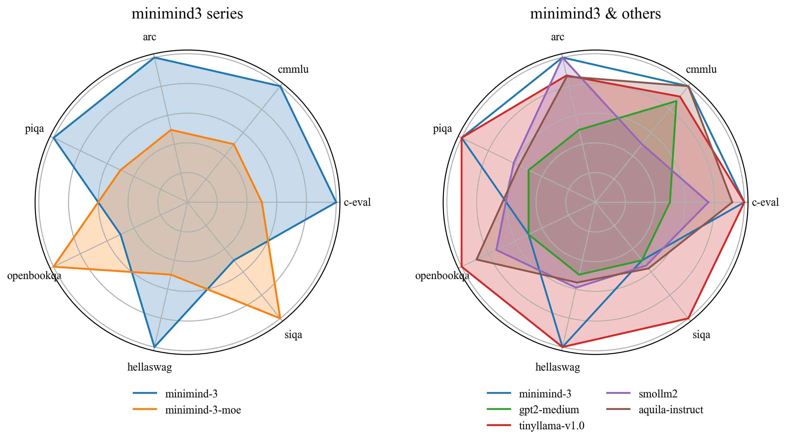

---

# 📌 Diğerleri

## 🔧 Model Dönüştürme

* [./scripts/convert_model.py](./scripts/convert_model.py), `torch` ve `transformers` model formatları arasında dönüşüm için kullanılabilir.
* Aksi belirtilmedikçe, ana `MiniMind` serisinden yayımlanan modeller genellikle `Transformers` formatında sunulur. Yerel `torch` ağırlıkları kullanıyorsanız lütfen önce `torch2transformers` dönüşümünü çalıştırın.


## 🖥️ MiniMind Tabanlı API Servis Arayüzü

* [./scripts/serve_openai_api.py](./scripts/serve_openai_api.py), OpenAI API ile uyumlu hafif bir sohbet servisi sunar; kendi modellerinizi FastGPT, OpenWebUI, Dify gibi üçüncü taraf arayüzlere bağlamayı kolaylaştırır.
* API sunucusu ayrıca `reasoning_content`, `tool_calls` ve `open_thinking` gibi alanları destekler; bu da onu Tool Calling / Thinking senaryoları için uygun kılar.

* Model ağırlıklarını [HuggingFace](https://huggingface.co/collections/jingyaogong/minimind-66caf8d999f5c7fa64f399e5)'ten indirdikten sonra dizin yapısı örneği aşağıdaki gibidir:
    ```
    minimind (kök dizin)
    ├─<MiniMind-Model-Name> (ör. minimind-3)
    |  ├── config.json
    |  ├── generation_config.json
    |  ├── model_minimind.py (isteğe bağlı, dışa aktarma formatına göre)
    |  ├── pytorch_model.bin veya model.safetensors
    |  ├── special_tokens_map.json
    |  ├── tokenizer_config.json
    |  ├── tokenizer.json
    ```

* Sunucuyu başlatın
    ```bash
    cd scripts && python serve_openai_api.py
    ```
* Servis arayüzünü test edin
    ```bash
    cd scripts && python chat_api.py
    ```
* API istek örneği (OpenAI API formatıyla uyumlu)
    ```bash
    curl http://localhost:8998/v1/chat/completions \
      -H "Content-Type: application/json" \
      -d '{ 
        "model": "model-identifier",
        "messages": [ 
          { "role": "user", "content": "世界上最高的山是什么？" }
        ], 
        "temperature": 0.7, 
        "max_tokens": 1024,
        "stream": true,
        "open_thinking": true
    }'
    ```

##  [SGLang](https://github.com/sgl-project/sglang)

SGLang, RadixAttention ve sürekli toplu işleme (continuous batching) gibi optimizasyonlara sahip, daha düşük gecikme ve daha yüksek verim sağlayan yüksek performanslı bir LLM çıkarım motorudur.

> ⚠️ CUDA ortamı gerektirir, ihtiyaca göre kullanın. Eğitim verimini artırmak için RL eğitim betiklerinde SGLang'ı rollout / çıkarım motoru olarak da seçebilirsiniz.

Modeli OpenAI uyumlu bir API sunucusu olarak başlatın:

```bash
python -m sglang.launch_server --model-path /path/to/model --attention-backend triton --host 0.0.0.0 --port 8998
```

##  [vllm](https://github.com/vllm-project/vllm)

vLLM, hızlı LLM dağıtımı için yaygın olarak kullanılan verimli bir çıkarım çerçevesidir; bellek verimliliği ile verim arasında iyi bir denge sunar.

> ⚠️ CUDA ortamı gerektirir, ihtiyaca göre kullanın.

Modeli OpenAI uyumlu bir API sunucusu olarak başlatın:

```bash
vllm serve /path/to/model --model-impl transformers --served-model-name "minimind" --port 8998
```

##  [llama.cpp](https://github.com/ggerganov/llama.cpp)

llama.cpp, komut satırından doğrudan kullanılabilen hafif ve pratik bir C++ çıkarım çerçevesidir. Çok iş parçacıklı çıkarımı ve çeşitli GPU hızlandırma seçeneklerini destekler.

**Dizin yapısı**: `llama.cpp` ve model dizinini aynı seviyedeki bir yola yerleştirmeniz önerilir

```
parent/
├── project/           # proje dizininiz
│   ├── minimind-model/       # HuggingFace formatındaki model dizini
│   │   ├── config.json
│   │   ├── model.safetensors
│   │   └── ...
│   └── ...
└── llama.cpp/         # llama.cpp dizini
    ├── build/
    ├── convert_hf_to_gguf.py
    └── ...
```

0. Kurulumu tamamlamak için `llama.cpp` resmî belgelerine bakın (`cmake` vb. bağımlılıklar)

1. `convert_hf_to_gguf.py` içindeki `get_vocab_base_pre` fonksiyonunun sonuna şunu ekleyin:

```python
# MiniMind tokenizer desteğini ekleyin. qwen2 gibi uyumlu bir yedek geçici olarak yeniden kullanılabilir.
if res is None:
    res = "qwen2"
```

2. HuggingFace formatındaki minimind modelini GGUF'a dönüştürün:

```bash
# Bunu llama.cpp dizininde çalıştırın. GGUF dosyası model dizininde oluşturulacaktır.
python convert_hf_to_gguf.py /path/to/minimind-model
```

3. Modeli nicemleyin (isteğe bağlı)

```bash
./build/bin/llama-quantize /path/to/model/xxxx.gguf /path/to/model/xxxx.q8.gguf Q8_0
```

4. Komut satırı çıkarım testi

```bash
./build/bin/llama-cli -m /path/to/model/xxxx.gguf
```

##  [ollama](https://ollama.ai)

Ollama, büyük modelleri yerel olarak çalıştırmak için yaygın kullanılan bir araçtır. Birçok açık kaynaklı LLM'i destekler ve düşük kurulum yüküyle basit bir iş akışı sunar.

1. Ollama aracılığıyla özel bir GGUF modeli yükleyin

Model dizininde yeni bir `minimind.modelfile` dosyası oluşturun ve aşağıdaki yapılandırma şablonunu yazın. Sistem prompt'unu ihtiyaca göre değiştirebilirsiniz:

<details>
<summary>minimind.modelfile (şablon)</summary>

```text
FROM /path/to/model/xxxx.gguf

SYSTEM "你的名字叫MiniMind，你是一个乐于助人、知识渊博的AI助手。请用完整且友好的方式回答用户问题，当被问到名字时请回答MiniMind。"


TEMPLATE """{{- if .Tools }}<|im_start|>system
{{ if .System }}{{ .System }}

{{ end }}# Tools

You may call one or more functions to assist with the user query.

You are provided with function signatures within <tools></tools> XML tags:
<tools>
{{- range .Tools }}
{"type": "function", "function": {{ .Function }}}
{{- end }}
</tools>

For each function call, return a json object with function name and arguments within <tool_call></tool_call> XML tags:
<tool_call>
{"name": <function-name>, "arguments": <args-json-object>}
</tool_call><|im_end|>
{{ else if .System }}<|im_start|>system
{{ .System }}<|im_end|>
{{ end }}
{{- range $i, $_ := .Messages }}
{{- $last := eq (len (slice $.Messages $i)) 1 -}}
{{- if eq .Role "user" }}<|im_start|>user
{{ .Content }}<|im_end|>
{{ else if eq .Role "assistant" }}<|im_start|>assistant
<think>
{{ .Thinking }}
</think>

{{ .Content }}
{{- if .ToolCalls }}
{{- range .ToolCalls }}
<tool_call>
{"name": "{{ .Function.Name }}", "arguments": {{ .Function.Arguments }}}
</tool_call>
{{- end }}
{{- end }}
{{- if not $last }}<|im_end|>
{{ end }}
{{- else if eq .Role "tool" }}<|im_start|>user
<tool_response>
{{ .Content }}
</tool_response><|im_end|>
{{ end }}
{{- if and (ne .Role "assistant") $last }}<|im_start|>assistant
{{ if and $.IsThinkSet $.Think -}}
<think>
{{ else -}}
<think>

</think>

{{ end -}}
{{ end }}
{{- end }}"""

PARAMETER repeat_penalty 1
PARAMETER stop "<|im_start|>"
PARAMETER stop "<|im_end|>"
PARAMETER temperature 0.9
PARAMETER top_p 0.9
PARAMETER num_ctx 8192
```

</details>
<br/>


2. Yerel modeli yükleyin ve adlandırın

```bash
ollama create -f minimind.modelfile minimind-local
```

3. Çıkarımı başlatın

```bash
ollama run minimind-local
```

<details>
<summary>📤 Modelinizi Ollama Hub'a gönderin</summary>

```bash
# 1. Yerel modeli ollama-hesabınız/minimind etiketiyle yeniden adlandırın
ollama cp minimind-local:latest your_username/minimind:latest

# 2. Modeli gönderin
ollama push your_username/minimind:latest
```
</details>
<br/>

⭐️ Hızlı başlangıç için benim sağladığım Ollama modelini doğrudan da kullanabilirsiniz:

```bash
ollama run jingyaogong/minimind-3
>>> 你叫什么名字
我是一个语言模型...
```

##  [MNN](https://github.com/alibaba/MNN)

MNN, uç cihazlar için tasarlanmış bir yapay zekâ çıkarım motorudur; çeşitli açık kaynaklı LLM'ler için hafif dağıtımı ve yüksek performanslı çıkarımı destekler.

1. Model dönüştürme
```bash
cd MNN/transformers/llm/export
# 4-bit HQQ nicemlenmiş bir MNN modeli dışa aktarın
python llmexport.py --path /path/to/model --export mnn --hqq --dst_path /path/to/model-mnn
```

2. Mac veya mobil cihazlarda test edin
```bash
./llm_demo /path/to/model-mnn/config.json prompt.txt
```
Alternatif olarak mobil uygulamayla da test edebilirsiniz.

> Bu üçüncü taraf çerçeveler hakkında daha fazla ayrıntı için lütfen resmî belgelerine bakın.


## 👨‍💻 Daha Fazla İçerik

* <a href="https://github.com/jingyaogong/minimind/discussions/618">🔗MiniMind-LLM'den Difüzyon Dil Modellerinin İnce Ayarı</a>

* <a href="https://github.com/jingyaogong/minimind/discussions/611">🔗Modelin generate Yönteminin Açıklaması</a>

* <a href="https://github.com/jingyaogong/minimind/discussions/704">🔗MiniMind'dan Doğrusal Dikkat Modellerinin Eğitimi</a>

# 📌 Teşekkürler

> [!NOTE]
> `MiniMind` serisi projeler size yardımcı olduysa, GitHub'da ⭐ vermekten çekinmeyin<br/>
> Belge uzundur ve eksiklikler kaçınılmazdır. Projenin birlikte iyileştirilmesine yardımcı olmak için Issue'lar veya PR'lar aracılığıyla geri bildirim sunabilirsiniz.<br/>
> Desteğiniz ve önerileriniz, bu projenin sürekli yinelenmesinin önemli itici güçleridir!

## 🤝[Katkıda Bulunanlar](https://github.com/jingyaogong/minimind/graphs/contributors)

<a href="https://github.com/jingyaogong/minimind/graphs/contributors">
  
</a>

## 😊Teşekkür

Eğitim notlarını, veri işleme deneyimlerini, öğreticileri ve kod incelemelerini paylaşan aşağıdaki katkıda bulunanlara teşekkür ederiz:

* [@ipfgao](https://github.com/ipfgao): [🔗Eğitim Adımı Kayıtları](https://github.com/jingyaogong/minimind/issues/26)

* [@WangRongsheng](https://github.com/WangRongsheng): [🔗Büyük Veri Kümesi Ön İşleme](https://github.com/jingyaogong/minimind/issues/39)

* [@pengqianhan](https://github.com/pengqianhan): [🔗Özlü Bir Öğretici](https://github.com/jingyaogong/minimind/issues/73)

* [@RyanSunn](https://github.com/RyanSunn): [🔗Çıkarım Süreci Öğrenme Notları](https://github.com/jingyaogong/minimind/issues/75)

* [@Nijikadesu](https://github.com/Nijikadesu): [🔗Proje Kodunu Etkileşimli Notebook Formatında Parçalara Ayırma](https://github.com/jingyaogong/minimind/issues/213)

* [@jaylearnstocode](https://github.com/jaylearnstocode): [🔗Model Mimarisi, Dikkat Mekanizmaları ve Eğitim Hatlarının Görselleştirilmesi](https://llm-visualization-minimind.vercel.app/)


Ayrıca aşağıdaki makalelere ve projelere de teşekkür ederiz:

- [https://github.com/meta-llama/llama3](https://github.com/meta-llama/llama3)
- [https://github.com/karpathy/llama2.c](https://github.com/karpathy/llama2.c)
- [https://github.com/DLLXW/baby-llama2-chinese](https://github.com/DLLXW/baby-llama2-chinese)
- [DeepSeek-V2](https://arxiv.org/abs/2405.04434)
- [https://github.com/charent/ChatLM-mini-Chinese](https://github.com/charent/ChatLM-mini-Chinese)
- [https://github.com/wdndev/tiny-llm-zh](https://github.com/wdndev/tiny-llm-zh)
- [Mistral-MoE](https://arxiv.org/pdf/2401.04088)
- [https://github.com/Tongjilibo/build_MiniLLM_from_scratch](https://github.com/Tongjilibo/build_MiniLLM_from_scratch)
- [https://github.com/jzhang38/TinyLlama](https://github.com/jzhang38/TinyLlama)
- [https://github.com/AI-Study-Han/Zero-Chatgpt](https://github.com/AI-Study-Han/Zero-Chatgpt)
- [https://github.com/xusenlinzy/api-for-open-llm](https://github.com/xusenlinzy/api-for-open-llm)
- [https://github.com/HqWu-HITCS/Awesome-Chinese-LLM](https://github.com/HqWu-HITCS/Awesome-Chinese-LLM)


## 🫶Destekçiler

<picture>
  <source media="(prefers-color-scheme: dark)" srcset="https://bytecrank.com/nastyox/reporoster/php/forkersSVG.php?user=jingyaogong&repo=minimind&theme=dark"/>
  <source media="(prefers-color-scheme: light)" srcset="https://bytecrank.com/nastyox/reporoster/php/forkersSVG.php?user=jingyaogong&repo=minimind"/>
  
</picture>

<picture>
  <source media="(prefers-color-scheme: dark)" srcset="https://api.star-history.com/chart?repos=jingyaogong/minimind&type=date&theme=dark&legend=top-left"/>
  <source media="(prefers-color-scheme: light)" srcset="https://api.star-history.com/chart?repos=jingyaogong/minimind&type=date&legend=top-left"/>
  
</picture>

## 🎉 MiniMind ile İlgili Başarılar

Bu model, birkaç memnuniyet verici araştırma çıktısı için bir basamak taşı olmuştur. Takdirleri için araştırmacılara teşekkür ederiz:

- ECG-Expert-QA: A Benchmark for Evaluating Medical Large Language Models in Heart Disease Diagnosis [[arxiv](https://arxiv.org/pdf/2502.17475)]

- Binary-Integer-Programming Based Algorithm for Expert Load Balancing in Mixture-of-Experts Models [[arxiv](https://arxiv.org/pdf/2502.15451)]

- LegalEval-Q: A New Benchmark for The Quality Evaluation of LLM-Generated Legal Text [[arxiv](https://arxiv.org/pdf/2505.24826)]

- On the Generalization Ability of Next-Token-Prediction Pretraining [[ICML 2025](https://openreview.net/forum?id=hLGJ1qZPdu)]

- 《从零开始写大模型：从神经网络到Transformer》王双、牟晨、王昊怡 编著 - 清华大学出版社

- FedBRB: A Solution to the Small-to-Large Scenario in Device-Heterogeneity Federated Learning [[TMC 2025](https://ieeexplore.ieee.org/abstract/document/11168259)]

- SKETCH: Semantic Key-Point Conditioning for Long-Horizon Vessel Trajectory Prediction [[arxiv](https://arxiv.org/pdf/2601.18537)]

- A Built-in Crypto Expert for Artificial Intelligence: How Far is the Horizon? [[IACR ePrint 2026](https://eprint.iacr.org/2026/411.pdf)]

- RetryTrigger: Intelligent Inference Duplication for Enhancing LLM Resilience to Hardware Transient Faults [[FITEE 2026](https://ieeexplore.ieee.org/abstract/document/11479682)]

- Devam ediyor...


# 🎓 Atıf

`MiniMind` araştırmanıza veya çalışmanıza yardımcı olduysa, atıf yapmaktan çekinmeyin:

```bibtex
@misc{minimind,
  title = {MiniMind: Train a Tiny LLM from Scratch},
  author = {Jingyao Gong},
  year = {2024},
  url = {https://github.com/jingyaogong/minimind},
  note = {GitHub repository}
}
```

# ⚖️ Lisans

Bu proje [Apache License 2.0](LICENSE) altında açık kaynak olarak yayımlanmıştır.
